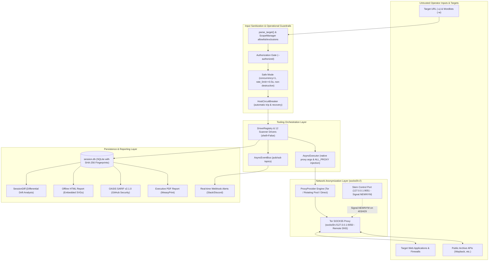

# ShadowRecon — Architecture & Codebase Map

## Overview
ShadowRecon (v3.4.0) is an enterprise-grade, asynchronous Python reconnaissance and vulnerability scanning pipeline designed for authorized security assessments.

### Core Architectural Tenets:
1. **Network Anonymization & Zero DNS Leaks**: Native `socks5h://` protocol injection across all sub-scanners and Python HTTP requests ensures both TCP streams and DNS lookups resolve strictly on remote Tor exit nodes. Pluggable proxy providers support Tor, rotating proxy pools, or direct execution.
2. **Asynchronous Streaming & Event Bus**: Central `AsyncEventBus` coordinates decoupled producers and consumers. Stages run with per-stage fault isolation, while progressive reconnaissance streaming yields real-time discoveries without blocking.
3. **Pluggable Scanner Driver Architecture**: Unified `ScannerDriver` interface and `DriverRegistry` decouple scanner implementations (12 external security tools) from pipeline orchestrators.
4. **Resilient Session Persistence & Drift Analysis**: SQLite `session.db` maintains full execution history, enabling instant resumption (`--force-rerun` to override). Deterministic finding fingerprints (`sha256(rule_id:endpoint:param:hash)`) enable cross-session differential drift analysis (`shadowrecon-diff`).
5. **Adaptive Offensive Engineering**: Automated WAF detection (`wafw00f`), active baseline probing, and mutation transforms (`url_double_encode`, `sql_comment_inline`, `case_alternate`, `unicode_normalize_encode`) dynamically feed bypass headers and vendor-specific SQLMap tamper scripts (`tamper/between.py,randomcase.py,...`) directly into active scanners.
6. **Production Safety & Circuit Breaking**: Per-host circuit breaker (`HostCircuitBreaker`) prevents scanner cascading failures. Safe mode enforces concurrency locks, request delays, and non-destructive scan profiles.
7. **Enterprise Multi-Format Reporting**: Self-contained dark offline HTML report with embedded SVG metrics, OASIS SARIF v2.1.0 for GitHub Security tab integration, PDF (via WeasyPrint), Markdown, JSON, CSV, and real-time webhook alerting (Slack/Discord).

---

## File-by-File Table

| File / Directory | Role | Dependencies & Interfaces |
|---|---|---|
| [`main.py`](main.py) | Lightweight CLI bootstrap shim delegating to `shadowrecon.cli`. | Imports and calls `shadowrecon.cli.main()`. |
| [`src/shadowrecon/__init__.py`](src/shadowrecon/__init__.py) | Package initialization and canonical version declaration (`__version__ = "3.4.0"`). | Standard library only. |
| [`src/shadowrecon/cli.py`](src/shadowrecon/cli.py) | Main asynchronous CLI entrypoint, argument parsing, banner, preflight doctor integration, session orchestration, and report dispatch. | `config.py`, `core/`, `storage/`, `pipeline/`, `modules/`, `reporting/`, `drivers/`. |
| [`src/shadowrecon/config.py`](src/shadowrecon/config.py) | Dataclass-based runtime configuration (`Config`), `BypassContext` (WAF bypass headers, mutations, and tamper scripts), and TOML file loader (`shadowrecon.toml`). | Standard library (`tomllib` / `tomli`). |
| [`src/shadowrecon/core/circuit.py`](src/shadowrecon/core/circuit.py) | Per-host circuit breaker (`HostCircuitBreaker`) tracking failure states, tripping on consecutive failures, and cooling down after recovery windows. | Standard library (`time`, `threading`). |
| [`src/shadowrecon/core/executor.py`](src/shadowrecon/core/executor.py) | Asynchronous process executor (`AsyncExecutor`) with native proxy flag injection (`-x`, `--proxy`, `-proxy-socks-url`), `ALL_PROXY` environment variable injection, circuit breaker integration, and dry-run simulation. | `asyncio.subprocess`, `core/circuit.py`, `core/proxy.py`. |
| [`src/shadowrecon/core/health.py`](src/shadowrecon/core/health.py) | Preflight environment checker (`PreflightChecker`, invoked via `--doctor`); validates required/optional CLI binaries, Tor SOCKS5 reachability, Tor ControlPort authentication, and directory write permissions. | `shutil`, `socket`, `stem`. |
| [`src/shadowrecon/core/proxy.py`](src/shadowrecon/core/proxy.py) | Pluggable proxy abstraction (`ProxyProvider`, `TorProxyProvider`, `ProxyPoolProvider`, `DirectProxyProvider`). | `core/tor.py`, `requests`. |
| [`src/shadowrecon/core/ratelimit.py`](src/shadowrecon/core/ratelimit.py) | Adaptive rate limiter (`AdaptiveRateLimiter`) implementing exponential backoff with jitter on 429/403 responses. | `asyncio`, `random`. |
| [`src/shadowrecon/core/scope.py`](src/shadowrecon/core/scope.py) | Target URL parsing (`parse_target`), scope validation (`ScopeManager`), wildcard/CIDR exclusion matcher, line readers, and string slugifiers. | `urllib.parse`, `ipaddress`, `fnmatch`. |
| [`src/shadowrecon/core/tor.py`](src/shadowrecon/core/tor.py) | Tor circuit manager (`TorManager`) communicating with Stem controller on port 9051 to signal `NEWNYM` circuit rotation upon rate limits or blocks. | `stem.control.Controller`. |
| [`src/shadowrecon/drivers/base.py`](src/shadowrecon/drivers/base.py) | Abstract base class `ScannerDriver` and centralized `DriverRegistry` enabling runtime driver swapping and stage discovery. | Standard library ABC. |
| [`src/shadowrecon/drivers/tools.py`](src/shadowrecon/drivers/tools.py) | Concrete scanner drivers for Subfinder, Assetfinder, Amass, HTTPX, Katana, Waybackpy, Gau, ParamSpider, Nuclei, Dalfox, SQLMap, and FFUF. | `drivers/base.py`, `core/executor.py`. |
| [`src/shadowrecon/modules/waf.py`](src/shadowrecon/modules/waf.py) | Stage 1: WAF fingerprinting (`wafw00f`), active baseline probing, mutation transform evaluation, and SQLMap tamper script mapping into `BypassContext`. | `waf_payloads.py`, `config.py`, `requests`. |
| [`src/shadowrecon/modules/recon.py`](src/shadowrecon/modules/recon.py) | Stages 2, 3, 6, 7: Subdomain enumeration, HTTP service probing with custom port matrices, URL crawling/archiving with deduplication, and directory fuzzing with multi-host concurrency. | `drivers/`, `storage/session.py`. |
| [`src/shadowrecon/modules/nuclei.py`](src/shadowrecon/modules/nuclei.py) | Stage 5: Nuclei scanning with CVSS severity filtering (`--severity`) and template tags (`--tags`). | `drivers/`, `storage/session.py`. |
| [`src/shadowrecon/modules/takeover.py`](src/shadowrecon/modules/takeover.py) | Stage 4: Subdomain takeover detection using targeted Nuclei takeover templates. | `core/executor.py`, `storage/session.py`. |
| [`src/shadowrecon/modules/vuln.py`](src/shadowrecon/modules/vuln.py) | Stages 8, 9, 10: Active vulnerability scanning — Dalfox (dynamic workers), SQLMap (batch chunking, timeouts, vendor tampers), and FFUF (LFI/SSRF). | `drivers/`, `config.py`, `storage/session.py`. |
| [`src/shadowrecon/pipeline/queue.py`](src/shadowrecon/pipeline/queue.py) | Pub/Sub asynchronous event bus (`AsyncEventBus`) for intra-stage communication and real-time finding notifications. | `asyncio.Queue`. |
| [`src/shadowrecon/pipeline/runner.py`](src/shadowrecon/pipeline/runner.py) | Pipeline runner (`PipelineRunner`) and stage execution context (`StageContext`); enforces fault isolation, resumption check, and timings. | `storage/session.py`, `config.py`. |
| [`src/shadowrecon/pipeline/progressive.py`](src/shadowrecon/pipeline/progressive.py) | Progressive reconnaissance streamer (`run_progressive_recon`); yields subdomains, live hosts, URLs, and findings in real time as async generators. | `pipeline/queue.py`, `pipeline/runner.py`. |
| [`src/shadowrecon/storage/session.py`](src/shadowrecon/storage/session.py) | SQLite session database (`SessionStore`) managing stages, subdomains, hosts, URLs, WAF bypasses, and findings with deterministic SHA-256 fingerprinting. | `sqlite3`, `hashlib`. |
| [`src/shadowrecon/storage/diff.py`](src/shadowrecon/storage/diff.py) | Cross-session differential drift analysis (`SessionDiff`, `diff_sessions`, standalone CLI `shadowrecon-diff`). | `storage/session.py`. |
| [`src/shadowrecon/reporting/html.py`](src/shadowrecon/reporting/html.py) | Offline dark HTML report generator with embedded SVG bar charts and zero external CDN dependencies. | `storage/session.py`, `html`. |
| [`src/shadowrecon/reporting/export.py`](src/shadowrecon/reporting/export.py) | Enterprise exporters: Markdown (`export_markdown`), PDF (`export_pdf` via WeasyPrint), SARIF v2.1.0 (`export_sarif`), JSON (`export_json`), and CSV (`export_csv`). | Standard library, optional `weasyprint`. |
| [`src/shadowrecon/reporting/webhook.py`](src/shadowrecon/reporting/webhook.py) | Webhook notification dispatcher (`send_webhook`, `attach_finding_notifier`) supporting Slack, Discord, and generic HTTP JSON endpoints. | `urllib.request`. |
| [`waf_payloads.py`](waf_payloads.py) | Data registry of WAF vendor profiles and payload mutation templates (preserved verbatim). | Python dictionary. |
| [`pyproject.toml`](pyproject.toml) | Packaging specifications, scripts (`shadowrecon`, `shadowrecon-diff`), dependencies, and test configurations. | PEP 517/621 build tooling. |
| [`requirements.txt`](requirements.txt) | Core runtime dependencies (`requests[socks]>=2.32`, `stem>=1.8`). | `pip`. |

---

## Pipeline Execution Sequence

```mermaid
sequenceDiagram
    autonumber
    actor Operator
    participant CLI as CLI & Preflight (cli.py)
    participant Bus as AsyncEventBus
    participant Runner as PipelineRunner
    participant WAF as WAF Module (waf.py)
    participant Recon as Recon Drivers (subfinder, httpx, katana)
    participant Vuln as Vuln Engines (dalfox, sqlmap, nuclei, ffuf)
    participant Store as SessionStore (session.db)
    participant Rep as Exporters (HTML, SARIF, PDF, Webhook)

    Operator->>CLI: shadowrecon -u https://target.com/ -w words.txt --authorized
    CLI->>CLI: PreflightChecker: verify binaries, Tor SOCKS & ControlPort
    CLI->>Store: Initialize session.db, record target, domain, version
    CLI->>Runner: Execute PipelineStages with StageContext

    rect rgb(20, 30, 45)
        note over Runner, WAF: Phase 1: WAF Detection & Mutation Testing
        Runner->>WAF: Fingerprint via wafw00f & baseline probe
        WAF->>WAF: Evaluate mutation transforms (encoding, comments, casing)
        WAF->>Store: Save winning bypass headers & map SQLMap tamper scripts
    end

    rect rgb(25, 35, 20)
        note over Runner, Recon: Phase 2: Reconnaissance & Asset Enumeration
        Runner->>Recon: subfinder (via SOCKS5) -> subdomains
        Recon-->>Bus: Publish discovered subdomains
        Runner->>Recon: httpx-toolkit (multi-port probing) -> live hosts
        Recon-->>Bus: Publish verified live hosts
        Runner->>Recon: katana + waybackpy + paramspider -> harvested URLs
        Recon->>Store: Deduplicate endpoints by query signature -> params.txt
        Runner->>Recon: ffuf (multi-host concurrent dir fuzzing)
    end

    rect rgb(35, 20, 30)
        note over Runner, Vuln: Phase 3: Targeted Active Vulnerability Scanning
        Runner->>Vuln: nuclei (takeover & CVSS templates)
        Runner->>Vuln: dalfox (XSS with dynamic worker scaling & bypass headers)
        Runner->>Vuln: sqlmap (SQLi with batch chunking, timeouts & vendor tampers)
        Runner->>Vuln: ffuf (LFI/SSRF against parameterized endpoints)
        Vuln->>Store: Record findings with SHA-256 deterministic fingerprints
        Vuln-->>Bus: Emit finding event -> Real-time Webhook alert (Slack/Discord)
    end

    rect rgb(30, 30, 40)
        note over CLI, Rep: Phase 4: Persistence, Drift & Multi-Format Reporting
        Runner-->>CLI: Pipeline execution complete
        CLI->>Store: Export flat artifacts (subdomains.txt, live.txt, params.txt)
        opt Differential Drift Analysis (--diff)
            CLI->>Store: diff_sessions(store, prior_session.db) -> drift_summary.json
        end
        CLI->>Rep: Generate Offline HTML report (embedded SVG charts)
        CLI->>Rep: Export SARIF v2.1.0, PDF, Markdown, JSON, CSV
        CLI->>Rep: Send completion summary webhook
        CLI->>Operator: Terminal summary table & output directory
    end
```

---

## Data Flow & Network Isolation

---

## Trust Boundaries & Security Model

1. **Operator Input & Scope Validation**:
   - Every target is parsed via `parse_target()`. Only valid HTTP/HTTPS URLs with valid domain names are accepted.
   - `ScopeManager` enforces an apex domain allowlist combined with exact hostname, wildcard pattern (e.g. `mail.*`), and CIDR block exclusions (e.g. `10.0.0.0/8`).
   - All external commands are executed as discrete argument vectors (`List[str]`) using Python's `asyncio.create_subprocess_exec` with `shell=False`, strictly eliminating shell injection vulnerabilities.

2. **Network Anonymization & DNS Leak Prevention**:
   - Outbound traffic strictly defaults to `socks5h://127.0.0.1:9050`. The `h` scheme ensures domain names are never resolved locally by the host OS DNS resolver; all name lookups happen remotely on the Tor exit node.
   - External CLI tools receive direct proxy flags (`-x`, `--proxy`, `-proxy-socks-url`) and the ambient subprocess environment is injected with `ALL_PROXY=socks5h://127.0.0.1:9050`.
   - On HTTP 403 or 429 response codes, `TorManager` sends an authenticated `NEWNYM` signal across Tor's control port (`9051`) to cycle the exit circuit.

3. **Storage, Diffing & Report Sanitization**:
   - All session data is strictly stored in the dedicated output directory (`runs/<domain>-<timestamp>/session.db`).
   - Vulnerabilities are assigned a deterministic SHA-256 fingerprint:
     $$\text{fingerprint} = \text{sha256}(\text{rule\_id} : \text{target\_url} : \text{param} : \text{payload})$$
     This guarantees idempotent storage and reliable cross-session drift comparison.
   - HTML report rendering passes all untrusted strings through `html.escape()`. SARIF and JSON exports serialize data strictly using standard JSON encoders.
