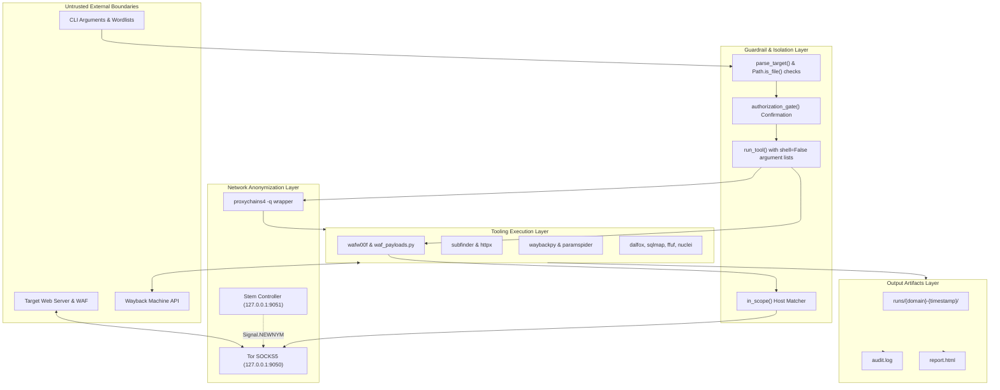

# ShadowRecon — Architecture & Codebase Map

## Overview
ShadowRecon is a Python 3 CLI reconnaissance and active vulnerability scanning pipeline designed for authorized security assessments.
It routes external security tools and HTTP requests through Tor with ProxyChains, automatically requesting new Tor circuits upon receiving HTTP 403 or 429 status codes.
The tool detects Web Application Firewalls (via `wafw00f`) and tests specific bypass mutations before orchestrating subdomain discovery, live host probing, archive extraction, directory fuzzing, and takeover testing.
Extracted parameterized endpoints are subsequently passed into active vulnerability scanners: Dalfox for XSS, SQLMap for SQL Injection, and FFUF for LFI/SSRF.
Execution results are recorded in a per-run audit log and aggregated into an offline, self-contained HTML report with dynamic charts.

## File-by-File Table

| File | Role | Talks To / Dependencies |
|---|---|---|
| [`main.py`](file:///home/omar/Projects/ShadowRecon/main.py) | Main orchestrator & CLI entrypoint; manages Tor circuit rotation, safe subprocess execution (`shell=False`), and stage coordination. | `console.py`, `report.py`, `waf_payloads.py`, `utils.py`, external CLI tools (`subfinder`, `httpx`, `waybackpy`, `ffuf`, `nuclei`, `paramspider`, `dalfox`, `sqlmap`, `wafw00f`, `proxychains`, `tor`). |
| [`waf_payloads.py`](file:///home/omar/Projects/ShadowRecon/waf_payloads.py) | Explicit WAF-bypass payload registry (`BYPASS` dict) containing mutation builders for 20 known WAF vendors plus default fallbacks. | Imported by `main.py` and `tests/test_shadowrecon.py`. |
| [`utils.py`](file:///home/omar/Projects/ShadowRecon/utils.py) | Pure standard-library helper functions (`parse_target`, `in_scope`, `slugify`, `read_lines`, `count_lines`). Zero third-party dependencies. | Used across `main.py`, `report.py`, and `tests/test_shadowrecon.py`. |
| [`console.py`](file:///home/omar/Projects/ShadowRecon/console.py) | CLI presentation layer; displays ASCII banner, logging formatters, and terminal summary tables. Uses `rich` when available, falling back to ANSI escape sequences. | `main.py`; optional `rich` library. |
| [`report.py`](file:///home/omar/Projects/ShadowRecon/report.py) | Offline HTML report builder; parses line-based and directory-based artifacts into structured sections, summary metrics cards, inline SVG charts, and collapsible details. | `utils.py`; produces `runs/<domain>-<timestamp>/report.html`. |
| [`tests/test_shadowrecon.py`](file:///home/omar/Projects/ShadowRecon/tests/test_shadowrecon.py) | Unit test suite verifying URL parsing, scope validation, line handling, WAF builder signatures, and HTML report compilation. | Tested via `python -m unittest` or `pytest`. |
| [`pyproject.toml`](file:///home/omar/Projects/ShadowRecon/pyproject.toml) | PEP 517/621 packaging metadata; specifies dependencies, scripts (`shadowrecon = main:main`), and pytest/bandit configurations. | Build tooling (`setuptools`). |
| [`requirements.txt`](file:///home/omar/Projects/ShadowRecon/requirements.txt) | Pinned Python runtime dependencies (`requests[socks]>=2.32`, `stem>=1.8`). | Python package installer (`pip`). |
| [`ANALYSIS.md`](file:///home/omar/Projects/ShadowRecon/ANALYSIS.md) | Historical architectural gap analysis; details security fixes (removal of command injection, credential leaks) from legacy v1 to v2. | Reference documentation. |
| [`SECURITY.md`](file:///home/omar/Projects/ShadowRecon/SECURITY.md) | Security policy document detailing SAST findings (`bandit`), accepted `# nosec` waivers, and dependency hygiene rules. | Reference documentation. |
| [`CHANGELOG.md`](file:///home/omar/Projects/ShadowRecon/CHANGELOG.md) | Standard changelog recording v2.0.0 refactoring details. | Reference documentation. |
| [`words.txt`](file:///home/omar/Projects/ShadowRecon/words.txt) | Minimal sample wordlist containing 3 entries (`admin`, `login`, `api`). | Used as input for `-w` during testing. |
| [`.github/workflows/ci.yml`](file:///home/omar/Projects/ShadowRecon/.github/workflows/ci.yml) | GitHub Actions CI matrix workflow for Python 3.9, 3.11, and 3.12. | GitHub Actions runner. |
| [`_stage/test_v1.py`](file:///home/omar/Projects/ShadowRecon/_stage/test_v1.py) | Historical intermediate test file for `utils.py`. | Staging / archival artifact. |
| [`_stage/test_v2.py`](file:///home/omar/Projects/ShadowRecon/_stage/test_v2.py) | Historical intermediate test file for `utils.py` and `waf_payloads.py`. | Staging / archival artifact. |
| [`ship/ShadowRecon Project Presentation.pdf`](file:///home/omar/Projects/ShadowRecon/ship/ShadowRecon%20Project%20Presentation.pdf) | Case study presentation documenting an authenticated profile XSS discovered on a target using ShadowRecon. | Reference / showcase documentation. |

## Pipeline Sequence

```mermaid
sequenceDiagram
    autonumber
    actor Operator
    participant Main as main.py (Orchestrator)
    participant Tor as Tor / Stem Controller
    participant WAF as WAF Module (wafw00f & waf_payloads)
    participant Recon as Recon Tools (subfinder, httpx, waybackpy, paramspider)
    participant Fuzz as Fuzzing & Scanning (ffuf, nuclei, dalfox, sqlmap)
    participant Rep as report.py

    Operator->>Main: python3 main.py -u URL -w wordlist --authorized
    Main->>Main: Validate URL & check required binaries
    Main->>Operator: Prompt confirmation (type domain)
    Main->>WAF: detect_waf() via wafw00f
    WAF-->>Main: Detected WAF name (or None)
    Main->>WAF: Send vendor-specific bypass payloads
    WAF->>Tor: HTTP requests via SOCKS5 proxy
    Tor-->>Main: HTTP Responses (log 200 OK hits)
    
    rect rgb(20, 30, 45)
        note over Main, Recon: Reconnaissance Phase
        Main->>Recon: subfinder -> subdomains.txt
        Main->>Recon: httpx -l subdomains.txt -> live.txt
        Main->>Recon: waybackpy --url target -> wayback.txt
        Main->>Recon: FFUF dir fuzzing on live hosts -> ffuf_dirs/*.csv
        Main->>Recon: nuclei takeovers on live hosts -> nuclei_takeover.txt
        Main->>Recon: Extract params from wayback.txt & run paramspider -> params.txt
    end

    rect rgb(35, 20, 30)
        note over Main, Fuzz: Active Scanning Phase
        Main->>Fuzz: dalfox file params.txt -> xss_dalfox.txt
        Main->>Fuzz: sqlmap -m params.txt -> sqlmap_out/
        opt LFI payloads provided
            Main->>Fuzz: ffuf with LFI wordlist against parameterized URLs -> ffuf_lfi_ssrf/*.csv
        end
    end

    Main->>Rep: collect(outdir) & generate(meta)
    Rep-->>Main: Written report.html
    Main->>Operator: Summary table & run directory path
```

## Data Flow and Trust Boundaries

### Trust Boundary Details:
1. **Operator Input Boundary**:
   - `args.url` is validated by `utils.parse_target()`. Only `http` and `https` schemes with valid hostnames are accepted; any invalid scheme or unparseable target throws a `ValueError`.
   - `args.wordlist` and optional `args.lfi_payloads` are strictly checked for file existence via `Path.is_file()`.
   - Command construction avoids `shell=True` and string interpolation; all CLI arguments are executed as discrete argument vectors (`argv` lists), preventing command injection.

2. **Network Request Boundary**:
   - Outbound HTTP requests from Python use Tor's SOCKS5 proxy (`socks5://127.0.0.1:9050`).
   - `utils.in_scope()` validates every generated payload URL against the target apex domain before dispatching, preventing scanning of out-of-scope third-party hosts.
   - External CLI tools are wrapped with `proxychains -q` (unless disabled via `--no-proxychains` or running `paramspider`, which handles its own network calls).

3. **Storage & Log Boundary**:
   - Artifacts are strictly scoped inside `runs/<domain>-<timestamp>/`.
   - Every external process invocation and HTTP interaction is recorded in `audit.log`.
   - In HTML report generation, text content from output files is sanitized through `html.escape()`.

## Verified Facts vs. Hypotheses

### Facts (Directly observed in codebase):
- The tool requires Python 3.9+ and external CLI tools (`subfinder`, `httpx`, `waybackpy`, `ffuf`, `nuclei`, `paramspider`, `dalfox`, `sqlmap`, `wafw00f`, `proxychains4`, `tor`).
- Active scanning requires the `--authorized` flag. If running interactively, the operator must confirm by retyping the target domain (bypassable in automation via `--yes`).
- WAF bypass payloads are static heuristics defined across 20 builders in `waf_payloads.py`.
- Subprocess invocations never use `shell=True`. Stdout redirection is handled natively in Python using `capture_to`.
- All tests pass (8 tests in `tests/test_shadowrecon.py`).

### Verified Findings on WAF Bypass Efficacy & ParamSpider Integration:
- **ParamSpider Filename & Directory Disconnect (Defect Verified)**:
  - In `/usr/lib/python3/dist-packages/paramspider/main.py` lines 105–110, ParamSpider writes results to a subdirectory named `results/` using the raw domain: `results/{domain}.txt` (e.g., `results/api.example.com.txt`).
  - In `main.py` lines 341–343, ShadowRecon expects output in the current working directory (`.`) with all dots replaced by underscores: `pf = Path(re.sub(r"[/:.]", "_", stem) + ".txt")` (e.g., `./api_example_com.txt`).
  - As a result, `pf.exists()` is always `False`, causing ShadowRecon to silently skip all ParamSpider results and merge 0 URLs.
- **WAF Bypass Heuristics Efficacy (Behavior Verified)**:
  - *Heuristics vs Modern WAFs*: The 20 builders in `waf_payloads.py` rely on legacy bypass tricks (e.g., `User-Agent: Googlebot`, `X-Forwarded-For: 127.0.0.1`, `%2e`, null bytes `%2500`, and custom headers like `X-NAXSI: test`). Modern cloud WAFs (Cloudflare, AWS WAF, Akamai Kona) employ forward-confirmed reverse DNS (FCrDNS), TLS/JA3/JA4 fingerprinting, and strict RFC 3986 URI normalization, rendering these simple header spoofing and path mutation tricks ineffective or even causing them to be flagged as malicious bot activity.
  - *No Attack Context*: `stage_waf` tests base URLs without offensive payloads (e.g., `https://example.com/` with `User-Agent: Googlebot`). Because the target URL returns 200 OK naturally, ShadowRecon marks it as a "WAF-bypass 200 OK", which is a false-positive indicator of bypass capability.
  - *Disconnected from Subsequent Stages*: Even if a mutation in `stage_waf` returns 200 OK, `main.py` does not propagate the successful header, method, or path mutation to the active scanning tools (`dalfox`, `sqlmap`, `ffuf`).

