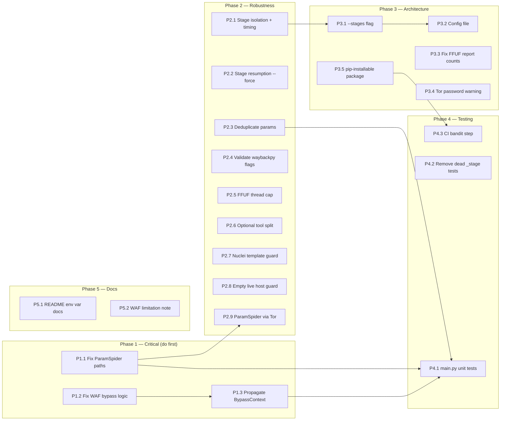

# ShadowRecon v2.0 — Detailed Improvement Plan

> **Scope:** Every gap is verified directly from source code. Nothing assumed.
> **Last updated:** 2026-10-25
> **Author:** Derived from full codebase reverse-engineering session.

---

## Table of Contents

1. [Gap Registry](#gap-registry)
2. [Phase 1 — Critical Bugs](#phase-1--critical-bugs)
3. [Phase 2 — Correctness & Robustness](#phase-2--correctness--robustness)
4. [Phase 3 — Architecture & Usability](#phase-3--architecture--usability)
5. [Phase 4 — Testing](#phase-4--testing)
6. [Phase 5 — Documentation & Packaging](#phase-5--documentation--packaging)
7. [Implementation Sequence](#implementation-sequence)

---

## Gap Registry

| ID | Severity | Category | Short Description | File(s) | Lines |
|----|----------|----------|-------------------|---------|-------|
| G01 | 🔴 Critical | Bug | ParamSpider file lookup always fails — 0 URLs ever merged | `main.py` | 333–349 |
| G02 | 🔴 Critical | Bug | WAF bypass 200 OK logged without any attack payload (false positive) | `main.py` | 227–250 |
| G03 | 🔴 Critical | Bug | Confirmed bypass mutations never forwarded to dalfox/sqlmap/ffuf | `main.py` | 253–266, 356–386 |
| G04 | 🟠 High | Architecture | Pipeline is all-or-nothing — one stage exception aborts everything | `main.py` | 523–536 |
| G05 | 🟠 High | Architecture | No resume/skip — re-runs repeat all stages from scratch | `main.py` | 273–386 |
| G06 | 🟠 High | Testing | Zero unit tests for `main.py` (541 lines, all core logic) | `tests/` | — |
| G07 | 🟠 High | Correctness | `waybackpy -ku` flag may not exist in installed version | `main.py` | 292–297 |
| G08 | 🟠 High | Correctness | `ffuf -t 50` (50 threads) is incompatible with Tor anonymization | `main.py` | 305–308 |
| G09 | 🟠 High | Correctness | `build_param_urls` does not deduplicate — thousands of dupes fed to scanners | `main.py` | 323–330 |
| G10 | 🟡 Medium | Architecture | All config is CLI-only; no persistent config file | `main.py` | 494–510 |
| G11 | 🟡 Medium | Architecture | `check_tools()` treats optional tools as required — aborts if any missing | `main.py` | 393–408 |
| G12 | 🟡 Medium | Architecture | Nuclei template path guessing silently scans nothing if paths miss | `main.py` | 312–320 |
| G13 | 🟡 Medium | Correctness | `fuzz_dirs_ffuf` logs "done" even when no live hosts exist | `main.py` | 300–309 |
| G14 | 🟡 Medium | Security | ParamSpider runs without Tor/proxychains — real IP exposed to Wayback | `main.py` | 336 |
| G15 | 🟡 Medium | UX | No per-stage timing — operators cannot identify bottlenecks | `main.py` | 523–536 |
| G16 | 🟡 Medium | UX | No `--stages` flag — cannot selectively run/skip pipeline stages | `main.py` | 494–510 |
| G17 | 🟡 Medium | Report | HTML report counts FFUF CSV files, not actual discovered paths | `report.py` | 49–57 |
| G18 | 🟢 Low | Packaging | Module imports assume CWD — tool breaks when installed via pip | `main.py`, `pyproject.toml` | 48–51 |
| G19 | 🟢 Low | Testing | `_stage/test_v1.py` and `_stage/test_v2.py` are dead, never run by CI | `_stage/` | — |
| G20 | 🟢 Low | Docs | `TOR_CONTROL_PASSWORD` env var is buried in README, missing startup warning | `README.md`, `main.py` | — |

---

## Phase 1 — Critical Bugs

> Must be fixed before any real scan can be trusted.

---

### P1.1 — Fix ParamSpider file resolution

**Gap:** G01
**Priority:** 🔴 Critical
**Effort:** Small (~30 lines changed)

#### Root Cause

Verified by reading both source files:

- **ParamSpider** (`/usr/lib/python3/dist-packages/paramspider/main.py:105–109`) writes output to:
  ```
  results/{raw_domain}.txt
  # e.g.: results/api.example.com.txt
  ```

- **ShadowRecon** (`main.py:341–343`) looks for:
  ```python
  stem = re.sub(r"^https?://", "", host)       # "api.example.com"
  pf = Path(re.sub(r"[/:.]", "_", stem) + ".txt")  # Path("api_example_com.txt") in CWD
  ```

Two independent mismatches:
1. **Directory**: ParamSpider creates `./results/`; ShadowRecon looks in `.`
2. **Filename**: ParamSpider preserves dots; ShadowRecon replaces them with underscores

`pf.exists()` is always `False`. All ParamSpider output is silently discarded.

#### Fix

**File:** `main.py:333–349`

Replace the entire `run_paramspider()` function:

```python
def run_paramspider(cfg: Config, live: Path, params: Path) -> None:
    """ParamSpider writes results/  {domain}.txt  (raw domain, dots preserved).
    Merge all in-scope parameterized URLs into params.txt."""
    run_tool(
        cfg,
        ["paramspider", "--list", str(live), "--proxy", cfg.tor_socks],
        proxychain=False,   # paramspider handles proxy itself via --proxy
        timeout=900,
    )
    results_dir = Path("results")   # ParamSpider's hardcoded output directory
    merged = 0
    with params.open("a", encoding="utf-8") as out:
        for host in read_lines(live):
            # Strip scheme; paramspider also strips it at main.py:152
            domain = re.sub(r"^https?://", "", host).lower().strip()
            pf = results_dir / f"{domain}.txt"          # actual file paramspider writes
            if not pf.exists():
                log.warning("ParamSpider output not found: %s (host: %s)", pf, host)
                continue
            for line in read_lines(pf):
                if "=" in line and line.startswith("http") and in_scope(line, cfg.domain):
                    out.write(line + "\n")
                    merged += 1
    log.info("ParamSpider merged %d URLs into %s", merged, params.name)
```

#### Tests to Add

**File:** `tests/test_shadowrecon.py` — new `TestParamSpider` class:

```python
class TestParamSpider(unittest.TestCase):
    def test_paramspider_correct_path_resolution(self):
        """Verify run_paramspider reads from results/{domain}.txt"""
        import tempfile, os
        with tempfile.TemporaryDirectory() as d:
            old_cwd = os.getcwd()
            os.chdir(d)
            try:
                results_dir = Path(d) / "results"
                results_dir.mkdir()
                (results_dir / "api.example.com.txt").write_text(
                    "https://api.example.com/v1?user=FUZZ\n", encoding="utf-8"
                )
                live = Path(d) / "live.txt"
                live.write_text("https://api.example.com\n", encoding="utf-8")
                params = Path(d) / "params.txt"
                params.write_text("", encoding="utf-8")
                # run with dry_run Config
                cfg = make_test_config(d, domain="example.com")
                run_paramspider(cfg, live, params)
                lines = params.read_text(encoding="utf-8").strip().splitlines()
                self.assertEqual(len(lines), 1)
                self.assertIn("user=FUZZ", lines[0])
            finally:
                os.chdir(old_cwd)
```

---

### P1.2 — Fix WAF bypass measurement logic

**Gap:** G02
**Priority:** 🔴 Critical
**Effort:** Medium (~60 lines changed)

#### Root Cause

`run_payloads()` (`main.py:227–250`) marks a response as a bypass whenever `resp.status_code == 200`. The payloads do not contain any attack content — they test whether the *base URL* remains accessible with a modified header. Any public target page returns 200 OK naturally. The log entry in `200-ok.txt` is therefore always a false positive.

A genuine WAF bypass test must:
1. Confirm the WAF actively blocks a known-bad request (baseline is 4xx).
2. Confirm the mutation causes the same request to succeed (200 OK).

#### Fix

**File:** `main.py:227–251` — replace `run_payloads()`:

```python
def run_payloads(cfg: Config, payloads: list) -> list[dict]:
    """Send WAF-bypass payloads via Tor. A result is only meaningful when the
    WAF is actively blocking (baseline 4xx) and the mutation returns 200 OK.

    Returns list of winning payload dicts for downstream propagation (P1.3).
    """
    # Step 1: establish baseline with a known-suspicious payload in the URL
    # e.g. add a SQLi-looking param that most WAFs fingerprint
    probe_url = cfg.target.rstrip("/") + "/?__shadowrecon_probe=1'OR'1'='1"
    baseline_blocked = False
    try:
        baseline_resp = http_request(cfg, "GET", probe_url)
        baseline_blocked = baseline_resp.status_code in BLOCK_STATUS_CODES
        log.info("WAF probe baseline: HTTP %d (blocked=%s)",
                 baseline_resp.status_code, baseline_blocked)
    except _DryRun:
        pass
    except ValueError as e:
        log.warning("Baseline probe out of scope: %s", e)
    except Exception as e:
        log.info("Baseline probe error: %s", e)

    hits_path = cfg.outdir / "200-ok.txt"
    winning_payloads: list[dict] = []

    with hits_path.open("a", encoding="utf-8") as fh:
        for p in payloads:
            test_url = p.get("url", cfg.target)
            method = p.get("method", "GET")
            # Re-inject the probe pattern into bypass test URLs too
            probe_test_url = test_url.rstrip("/") + "/?__shadowrecon_probe=1'OR'1'='1" \
                if "?" not in test_url else test_url + "&__shadowrecon_probe=1'OR'1'='1"
            try:
                resp = http_request(cfg, method, probe_test_url,
                                    headers=p.get("headers", {}),
                                    data=p.get("data"))
            except _DryRun:
                continue
            except ValueError as e:
                log.warning("%s", e)
                continue
            except Exception as e:
                log.info("[%s] error: %s", p["desc"], e)
                continue

            msg = (f"[{p['desc']}] -> {method} {probe_test_url} | "
                   f"{resp.status_code} | len={len(resp.text)}")
            log.info(msg)

            # Only record as bypass if WAF was blocking AND mutation bypassed it
            if resp.status_code == 200 and baseline_blocked:
                fh.write(msg + "\n")
                winning_payloads.append(p)
                log.info("  *** BYPASS CONFIRMED: %s ***", p["desc"])
            elif resp.status_code == 200 and not baseline_blocked:
                log.debug("  [skip] WAF not blocking baseline; result uninformative.")

    return winning_payloads
```

Also update `stage_waf()` to capture and return the winning list:

```python
def stage_waf(cfg: Config) -> list[dict]:
    name = detect_waf(cfg)
    builder = waf_payloads.default_payloads
    if name:
        for key, fn in waf_payloads.BYPASS.items():
            if key in name:
                log.info("Running %s payload set ...", key)
                builder = fn
                break
        else:
            log.info("Unknown WAF — using generic payload set.")
    else:
        log.info("Using generic payload set.")
    return run_payloads(cfg, builder(cfg.target))
```

> **Note on scope:** The probe URL (`?__shadowrecon_probe=1'OR'1'='1`) is appended to the target base URL — it stays in scope. `http_request()` will validate it through `in_scope()` before dispatching.

---

### P1.3 — Propagate confirmed bypass context to downstream scanners

**Gap:** G03
**Priority:** 🔴 Critical
**Effort:** Medium (~50 lines changed)

#### Root Cause

`stage_waf()` currently returns `None`. Even if a bypass header is confirmed, `xss_with_dalfox()`, `sqli_with_sqlmap()`, and `lfi_ssrf_with_ffuf()` receive no information about it and run with plain default requests.

#### Fix — Step A: Add `BypassContext` dataclass

**File:** `main.py` — after the `Config` dataclass (~line 98):

```python
@dataclass
class BypassContext:
    """Carries a confirmed WAF-bypass mutation into downstream scanning tools."""
    headers: dict = field(default_factory=dict)   # e.g. {"X-Forwarded-For": "127.0.0.1"}
    method_override: str = ""                     # e.g. "HEAD" (if bypass used unusual method)
    path_prefix: str = ""                         # e.g. "%2e" (if bypass used path mutation)
    desc: str = "none"                            # human-readable label for logging

    @classmethod
    def from_payload(cls, p: dict) -> "BypassContext":
        return cls(
            headers=p.get("headers", {}),
            method_override=p.get("method", ""),
            desc=p.get("desc", ""),
        )

    def dalfox_args(self) -> list[str]:
        """Extra CLI args to inject the bypass into Dalfox."""
        args = []
        for k, v in self.headers.items():
            args += ["--header", f"{k}: {v}"]
        return args

    def sqlmap_args(self) -> list[str]:
        """Extra CLI args to inject the bypass into SQLMap."""
        if not self.headers:
            return []
        header_str = "\n".join(f"{k}: {v}" for k, v in self.headers.items())
        return ["--headers", header_str]

    def ffuf_args(self) -> list[str]:
        """Extra CLI args to inject the bypass into FFUF."""
        args = []
        for k, v in self.headers.items():
            args += ["-H", f"{k}: {v}"]
        return args
```

#### Fix — Step B: Wire `BypassContext` into scanning stages

**File:** `main.py:356–387`

Update each scanning function signature to accept an optional `BypassContext`:

```python
def xss_with_dalfox(cfg: Config, params: Path,
                    bypass: BypassContext | None = None) -> Path:
    out = cfg.outdir / "xss_dalfox.txt"
    extra = bypass.dalfox_args() if bypass else []
    run_tool(cfg, ["dalfox", "file", str(params),
                   "--only-poc", "--worker", "1", "-o", str(out),
                   *extra], timeout=600)
    log.info("Dalfox XSS done -> %s", out.name)
    return out


def sqli_with_sqlmap(cfg: Config, params: Path,
                     bypass: BypassContext | None = None) -> Path:
    out = cfg.outdir / "sqlmap_out"
    out.mkdir(exist_ok=True)
    extra = bypass.sqlmap_args() if bypass else []
    run_tool(cfg, ["sqlmap", "-m", str(params), "--batch", "--random-agent",
                   "--level", "1", "--risk", "1", f"--output-dir={out}",
                   *extra], timeout=3600)
    log.info("SQLMap run finished -> %s", out.name)
    return out


def lfi_ssrf_with_ffuf(cfg: Config, params: Path,
                        bypass: BypassContext | None = None) -> None:
    if not cfg.lfi_payloads:
        return
    out_dir = cfg.outdir / "ffuf_lfi_ssrf"
    out_dir.mkdir(exist_ok=True)
    extra = bypass.ffuf_args() if bypass else []
    for base in read_lines(params):
        if "=" not in base:
            continue
        url = re.sub(r"=([^&]*)", "=FUZZ", base, count=1)
        run_tool(cfg, ["ffuf", "-w", str(cfg.lfi_payloads), "-u", url,
                       "-mc", "200,500", "-of", "csv",
                       "-o", str(out_dir / f"{slugify(url)}.csv"),
                       *extra], timeout=1200)
    log.info("FFUF LFI/SSRF fuzzing -> %s", out_dir.name)
```

#### Fix — Step C: Update `main()` to pass bypass context

**File:** `main.py:523–534`

```python
winning_payloads = stage_waf(cfg)                    # now returns list[dict]
bypass = BypassContext.from_payload(winning_payloads[0]) if winning_payloads else None
if bypass:
    log.info("Downstream scanners will use bypass: %s", bypass.desc)

subs = enum_subdomains(cfg)
live = probe_httpx(cfg, subs)
wayback = wayback_urls(cfg)
fuzz_dirs_ffuf(cfg, live)
nuclei_takeover(cfg, live)
params = build_param_urls(cfg, wayback)
run_paramspider(cfg, live, params)
xss_with_dalfox(cfg, params, bypass=bypass)
sqli_with_sqlmap(cfg, params, bypass=bypass)
lfi_ssrf_with_ffuf(cfg, params, bypass=bypass)
```

---

## Phase 2 — Correctness & Robustness

---

### P2.1 — Wrap each stage in isolated error handling with timing

**Gap:** G04, G15
**Priority:** 🟠 High
**Effort:** Small (~40 lines)

#### Root Cause

`main()` calls stages sequentially with no exception isolation. Any unhandled error aborts everything — no partial report, no timing info.

#### Fix

**File:** `main.py` — add `run_stage()` helper above `main()`:

```python
import time as _time   # already imported as `time`

def run_stage(name: str, fn, *args, **kwargs):
    """Run a pipeline stage with error isolation and timing.
    Returns the function's return value, or None on failure."""
    log.info("━━━ Stage start: %s ━━━", name)
    t0 = _time.monotonic()
    try:
        result = fn(*args, **kwargs)
        elapsed = _time.monotonic() - t0
        log.info("━━━ Stage done:  %s  (%.1fs) ━━━", name, elapsed)
        return result
    except Exception as e:
        elapsed = _time.monotonic() - t0
        log.error("━━━ Stage FAILED: %s  (%.1fs) — %s ━━━", name, elapsed, e)
        return None
```

Update `main()` to use `run_stage()`:

```python
def main(...):
    ...
    winning = run_stage("waf",        stage_waf,        cfg)          or []
    bypass  = BypassContext.from_payload(winning[0]) if winning else None
    subs    = run_stage("subdomains", enum_subdomains,  cfg)          or cfg.outdir / "subdomains.txt"
    live    = run_stage("live-hosts", probe_httpx,      cfg, subs)    or cfg.outdir / "live.txt"
    wayback = run_stage("wayback",    wayback_urls,     cfg)          or cfg.outdir / "wayback.txt"
            ; run_stage("dirs",       fuzz_dirs_ffuf,   cfg, live)
            ; run_stage("takeover",   nuclei_takeover,  cfg, live)
    params  = run_stage("params",     build_param_urls, cfg, wayback) or cfg.outdir / "params.txt"
            ; run_stage("paramspider",run_paramspider,  cfg, live, params)
            ; run_stage("xss",        xss_with_dalfox,  cfg, params, bypass=bypass)
            ; run_stage("sqli",       sqli_with_sqlmap, cfg, params, bypass=bypass)
            ; run_stage("lfi",        lfi_ssrf_with_ffuf,cfg,params, bypass=bypass)
    finish(cfg, started)
```

---

### P2.2 — Add stage resumption (skip if output already exists)

**Gap:** G05
**Priority:** 🟠 High
**Effort:** Medium (~60 lines)

#### Fix

**File:** `main.py` — add `stage_done()` helper and `--force` flag:

```python
def stage_done(path: Path, cfg: Config) -> bool:
    """True if a stage artifact exists, is non-empty, and --force was not set."""
    if cfg.force_rerun:
        return False
    return path.exists() and path.stat().st_size > 0
```

**File:** `main.py:494–510` — add CLI flag:

```python
ap.add_argument("--force", action="store_true",
    help="Re-run all stages even if their output files already exist.")
```

**File:** `main.py` — `Config` dataclass:

```python
force_rerun: bool = False
```

**File:** `main.py:273–281` — apply in each stage:

```python
def enum_subdomains(cfg: Config) -> Path:
    out = cfg.outdir / "subdomains.txt"
    if stage_done(out, cfg):
        log.info("Skipping subdomains — %s exists (%d lines)", out.name, count_lines(out))
        return out
    ...   # existing logic unchanged
```

Apply the same pattern at the top of: `probe_httpx`, `wayback_urls`, `fuzz_dirs_ffuf`, `nuclei_takeover`, `xss_with_dalfox`, `sqli_with_sqlmap`.

---

### P2.3 — Deduplicate `params.txt` by (path, param_names)

**Gap:** G09
**Priority:** 🟠 High
**Effort:** Small (~20 lines)

#### Root Cause

`build_param_urls()` (`main.py:323–330`) writes every URL with `=` directly from wayback output. Wayback archives frequently contain thousands of identical endpoint patterns with only parameter *values* varying (e.g. `?id=1`, `?id=2`, ...). SQLMap and Dalfox run duplicated tests.

#### Fix

**File:** `main.py:323–330` — replace `build_param_urls()`:

```python
def build_param_urls(cfg: Config, wayback: Path) -> Path:
    """Collect parameterized URLs from wayback; deduplicate by
    (netloc + path + frozenset of param names) to avoid redundant scans."""
    from urllib.parse import urlparse, parse_qs
    out = cfg.outdir / "params.txt"
    seen: set = set()
    with out.open("w", encoding="utf-8") as fh:
        for u in read_lines(wayback):
            if "=" not in u:
                continue
            try:
                p = urlparse(u)
                sig = (p.netloc, p.path, frozenset(parse_qs(p.query).keys()))
            except Exception:
                sig = u   # fallback: treat whole URL as signature
            if sig in seen:
                continue
            seen.add(sig)
            fh.write(u + "\n")
    log.info("Parameterized URLs (deduplicated): %d -> %s", count_lines(out), out.name)
    return out
```

---

### P2.4 — Validate `waybackpy` CLI flags at startup

**Gap:** G07
**Priority:** 🟠 High
**Effort:** Small (~15 lines)

#### Root Cause

`run_tool(cfg, ["waybackpy", "--url", cfg.domain, "-ku"], ...)` uses `-ku`. In `waybackpy` version 3.x+ the flag is `--known-urls`. Older versions may use `-ku`. If the flag is wrong, the command fails with a non-zero exit code, `run_tool()` returns `""`, and `capture_to` writes an empty file. The operator sees `"Wayback URLs: 0"` with no error.

#### Fix

**File:** `main.py:393–408` — inside `check_tools()`, add after the tool loop:

```python
# Validate waybackpy CLI interface
if shutil.which("waybackpy"):
    out = subprocess.run(["waybackpy", "--help"],
                         capture_output=True, text=True, timeout=10)
    help_text = out.stdout + out.stderr
    if "-ku" not in help_text and "--known-urls" not in help_text:
        log.warning(
            "waybackpy: cannot detect known-urls flag (-ku / --known-urls). "
            "Check your waybackpy version — 'waybackpy --help' for the correct flag."
        )
```

**File:** `main.py:292–297` — make the flag configurable:

```python
WAYBACKPY_KNOWN_URLS_FLAG = "-ku"   # override if your version uses --known-urls

def wayback_urls(cfg: Config) -> Path:
    out = cfg.outdir / "wayback.txt"
    run_tool(cfg, ["waybackpy", "--url", cfg.domain, WAYBACKPY_KNOWN_URLS_FLAG],
             timeout=900, capture_to=out)
    log.info("Wayback URLs: %d -> %s", count_lines(out), out.name)
    return out
```

---

### P2.5 — Reduce FFUF thread count for Tor compatibility

**Gap:** G08
**Priority:** 🟠 High
**Effort:** Small (~10 lines)

#### Root Cause

`ffuf -t 50` sends 50 concurrent goroutines through the same Tor SOCKS proxy. Each goroutine opens its own TCP connection through the exit node. This saturates a single Tor circuit, triggers WAF rate-limiting, and risks traffic correlation de-anonymization.

#### Fix

**File:** `main.py:494–510` — new flag:

```python
ap.add_argument("--ffuf-threads", type=int, default=5,
    help="FFUF concurrency level (default: 5, tuned for Tor).")
```

**File:** `main.py:77–97` — add to `Config`:

```python
ffuf_threads: int = 5
```

**File:** `main.py:300–309` — use in `fuzz_dirs_ffuf()`:

```python
"-t", str(cfg.ffuf_threads)
```

Operators who know Tor is fast on their exit or who use `--no-proxychains` can increase this with `--ffuf-threads 20`.

---

### P2.6 — Separate required from optional tools

**Gap:** G11
**Priority:** 🟡 Medium
**Effort:** Small (~25 lines)

#### Fix

**File:** `main.py:57–69` — split the `TOOLS` dict:

```python
REQUIRED_TOOLS = {
    "subfinder": "go install -v github.com/projectdiscovery/subfinder/v2/cmd/subfinder@latest",
    "httpx":     "go install -v github.com/projectdiscovery/httpx/cmd/httpx@latest",
    "ffuf":      "sudo apt install ffuf",
    "nuclei":    "go install -v github.com/projectdiscovery/nuclei/v3/cmd/nuclei@latest",
    "dalfox":    "go install github.com/hahwul/dalfox/v2@latest",
    "sqlmap":    "sudo apt install sqlmap",
    "wafw00f":   "pipx install wafw00f",
}

OPTIONAL_TOOLS = {
    "proxychains": "sudo apt install proxychains4  (used unless --no-proxychains)",
    "paramspider": "pipx install paramspider  (parameter mining)",
    "tor":         "sudo apt install tor + configure ControlPort",
    "waybackpy":   "pipx install waybackpy  (historical URL mining)",
}
```

**File:** `main.py:393–408` — update `check_tools()`:

```python
def check_tools(cfg: Config) -> None:
    if sys.platform != "linux":
        log.warning("This pipeline targets Linux. Some tools may be unavailable on %s.",
                    sys.platform)
    missing_req, missing_opt = [], []
    log.info("Tool check:")
    for tool, hint in REQUIRED_TOOLS.items():
        if shutil.which(tool):
            log.info("  [OK]      %s", tool)
        else:
            log.warning("  [MISSING] %s  —  install: %s", tool, hint)
            missing_req.append(tool)
    for tool, hint in OPTIONAL_TOOLS.items():
        if shutil.which(tool):
            log.info("  [OK opt]  %s", tool)
        else:
            log.info("  [skip]    %s (optional)  —  %s", tool, hint)
            missing_opt.append(tool)
    if missing_req and not cfg.dry_run:
        log.error("Missing required tools: %s. Install them or use --dry-run.",
                  ", ".join(missing_req))
        sys.exit(1)
```

---

### P2.7 — Guard Nuclei with template existence check + clear error

**Gap:** G12
**Priority:** 🟡 Medium
**Effort:** Small (~10 lines)

#### Fix

**File:** `main.py:312–320`:

```python
def nuclei_takeover(cfg: Config, live: Path) -> Path:
    out = cfg.outdir / "nuclei_takeover.txt"
    templates = cfg.nuclei_templates / "http" / "takeovers"
    if not templates.exists():
        templates = cfg.nuclei_templates / "takeovers"
    if not templates.exists():
        log.error(
            "Nuclei takeover templates not found at %s. "
            "Download them with:  nuclei -update-templates",
            cfg.nuclei_templates,
        )
        return out   # return empty path; don't abort pipeline
    run_tool(cfg, ["nuclei", "-l", str(live), "-t", str(templates),
                   "-o", str(out), "-timeout", "50"], timeout=3600)
    log.info("Nuclei takeover scan done -> %s", out.name)
    return out
```

---

### P2.8 — Guard FFUF and ParamSpider when `live.txt` is empty

**Gap:** G13
**Priority:** 🟡 Medium
**Effort:** Tiny (~5 lines per function)

#### Fix

**File:** `main.py:300–309` — at the top of `fuzz_dirs_ffuf()`:

```python
def fuzz_dirs_ffuf(cfg: Config, live: Path) -> None:
    hosts = read_lines(live)
    if not hosts:
        log.warning("No live hosts found — skipping directory fuzzing.")
        return
    ffuf_dir = cfg.outdir / "ffuf_dirs"
    ...
```

**File:** `main.py:333` — at the top of `run_paramspider()`:

```python
def run_paramspider(cfg: Config, live: Path, params: Path) -> None:
    if not read_lines(live):
        log.warning("No live hosts found — skipping ParamSpider.")
        return
    ...
```

Same guard for `nuclei_takeover()`.

---

### P2.9 — Route ParamSpider through Tor SOCKS proxy

**Gap:** G14
**Priority:** 🟡 Medium
**Effort:** Tiny (~2 lines)

#### Root Cause

`run_tool(..., proxychain=False)` and ParamSpider's `--proxy` not being set means all Wayback Machine requests are made on the real IP.

#### Fix

Already incorporated into the P1.1 fix:

```python
run_tool(
    cfg,
    ["paramspider", "--list", str(live), "--proxy", cfg.tor_socks],
    proxychain=False,
    timeout=900,
)
```

`cfg.tor_socks` defaults to `"socks5://127.0.0.1:9050"`. ParamSpider's `client.py:44–48` passes the proxy dict to `requests.get()`.

---

## Phase 3 — Architecture & Usability

---

### P3.1 — Add `--stages` / `--skip-stages` flag

**Gap:** G16
**Priority:** 🟡 Medium
**Effort:** Medium (~80 lines)

#### Fix

**File:** `main.py:494–510` — new flags:

```python
ap.add_argument("--stages", default="all",
    help="Comma-separated stages to run. "
         "Choices: waf,subdomains,live,wayback,dirs,takeover,params,xss,sqli,lfi. "
         "Default: all")
ap.add_argument("--skip-stages", default="",
    help="Comma-separated stages to skip (applied after --stages).")
```

**File:** `main.py:513–536` — refactor `main()` using a stage registry:

```python
ALL_STAGES = ["waf","subdomains","live","wayback","dirs",
              "takeover","params","paramspider","xss","sqli","lfi"]

def parse_stages(raw: str, skip_raw: str) -> set[str]:
    chosen = set(ALL_STAGES) if raw.strip().lower() == "all" \
             else {s.strip() for s in raw.split(",") if s.strip()}
    skip   = {s.strip() for s in skip_raw.split(",") if s.strip()}
    return chosen - skip

def main(...):
    args  = parse_args(argv)
    cfg   = build_config(args)
    active = parse_stages(args.stages, args.skip_stages)
    log.info("Active stages: %s", sorted(active))

    results: dict = {}
    if "waf"         in active: results["bypass"] = run_stage("waf",          stage_waf,          cfg) or []
    if "subdomains"  in active: results["subs"]   = run_stage("subdomains",   enum_subdomains,    cfg) or cfg.outdir/"subdomains.txt"
    if "live"        in active: results["live"]   = run_stage("live",         probe_httpx,        cfg, results.get("subs", cfg.outdir/"subdomains.txt"))
    ...   # pattern continues for each stage
    finish(cfg, started)
```

---

### P3.2 — Add config file support

**Gap:** G10
**Priority:** 🟡 Medium
**Effort:** Medium (~60 lines, new `config.py`)

#### Fix

Create `config.py` (or extend `utils.py`) with a TOML/INI loader. Python 3.11+ includes `tomllib` in stdlib:

```python
# config.py
from __future__ import annotations
import sys
from pathlib import Path
from typing import Any

def load_config(path: Path | None) -> dict[str, Any]:
    if path is None:
        return {}
    if not path.exists():
        return {}
    if sys.version_info >= (3, 11):
        import tomllib
        return tomllib.loads(path.read_text(encoding="utf-8"))
    try:
        import tomli
        return tomli.loads(path.read_text(encoding="utf-8"))
    except ImportError:
        import configparser
        cp = configparser.ConfigParser()
        cp.read(path)
        return dict(cp["shadowrecon"]) if "shadowrecon" in cp else {}
```

Sample `shadowrecon.toml`:

```toml
[shadowrecon]
outdir            = "runs"
rate_limit        = 0.5
ffuf_threads      = 5
tor_control_port  = 9051
no_proxychains    = false
nuclei_templates  = "~/nuclei-templates"
```

**File:** `main.py:435–463` — in `build_config()`, merge file config before CLI args:

```python
def build_config(args: argparse.Namespace) -> Config:
    from config import load_config
    file_cfg = load_config(Path(args.config) if args.config else Path("shadowrecon.toml"))
    # CLI args take precedence over file values
    rate_limit = args.rate_limit if args.rate_limit != 0.0 else float(file_cfg.get("rate_limit", 0.0))
    ...
```

**File:** `main.py:494` — add `--config` flag:

```python
ap.add_argument("--config", default=None,
    help="Path to TOML/INI config file (CLI flags override). "
         "Default: ./shadowrecon.toml if it exists.")
```

---

### P3.3 — Fix HTML report FFUF result counts

**Gap:** G17
**Priority:** 🟡 Medium
**Effort:** Small (~20 lines)

#### Root Cause

`report.py:49–57` counts the number of FFUF *CSV files* (one per scanned host), not the number of discovered paths inside them. A scan of 5 hosts with 0 found paths shows `5` in the summary card.

#### Fix

**File:** `report.py` — add helper and update `collect()`:

```python
def _count_ffuf_hits(csv_path: Path) -> int:
    """Count non-header rows in an FFUF CSV (each row = one found path)."""
    lines = read_lines(csv_path)   # read_lines strips blank lines
    # FFUF CSV header: FUZZ,url,redirectlocation,position,status_code,...
    # Skip the header row
    return max(0, len(lines) - 1)

# In collect():
ffuf = run_dir / "ffuf_dirs"
if ffuf.is_dir():
    csvs = sorted(ffuf.glob("*.csv"))
    total_hits = sum(_count_ffuf_hits(p) for p in csvs)
    sections.append(Section(
        "Directory fuzz (FFUF)", "info", total_hits,
        [p.name for p in csvs],
        note=f"across {len(csvs)} host(s)"
    ))
```

---

### P3.4 — Warn on startup when Tor password is absent

**Gap:** G20
**Priority:** 🟡 Medium
**Effort:** Tiny (~5 lines)

#### Fix

**File:** `main.py:513–518` — in `main()` after `build_config()`:

```python
if not cfg.tor_control_password and not cfg.dry_run:
    log.warning(
        "TOR_CONTROL_PASSWORD is not set — Tor circuit rotation is DISABLED. "
        "Set it via:  export TOR_CONTROL_PASSWORD='your-pass'  "
        "or pass --tor-pass. Without it, a blocked request will not rotate IPs."
    )
```

---

### P3.5 — Make the package pip-installable

**Gap:** G18
**Priority:** 🟢 Low
**Effort:** Medium (file restructure)

#### Fix

Restructure to a `src/` layout:

```
src/
  shadowrecon/
    __init__.py
    main.py
    utils.py
    console.py
    report.py
    waf_payloads.py
    config.py
tests/
  test_shadowrecon.py
pyproject.toml
```

**File:** `pyproject.toml`:

```toml
[tool.setuptools.packages.find]
where = ["src"]

[project.scripts]
shadowrecon = "shadowrecon.main:main"

[tool.setuptools]
# remove the old py-modules line
```

Convert all flat imports inside the package:

```python
# Before:
import console
import report

# After:
from shadowrecon import console, report
from shadowrecon.utils import ...
```

---

## Phase 4 — Testing

---

### P4.1 — Unit tests for `main.py` core functions

**Gap:** G06
**Priority:** 🟠 High
**Effort:** Medium (~150 lines of new tests)

#### New Test Class: `TestCoreLogic`

**File:** `tests/test_shadowrecon.py`

```python
from unittest.mock import patch, MagicMock, call
import sys, os, tempfile
from pathlib import Path

sys.path.insert(0, str(Path(__file__).resolve().parent.parent))
import main
from main import (Config, BypassContext, build_param_urls,
                  run_paramspider, detect_waf, authorization_gate,
                  http_request, _DryRun)

def make_test_cfg(outdir: str, domain="example.com", dry_run=True) -> Config:
    return Config(
        target=f"https://{domain}/",
        domain=domain,
        wordlist=Path("words.txt"),
        outdir=Path(outdir),
        dry_run=dry_run,
    )

class TestHttpRequest(unittest.TestCase):
    def test_out_of_scope_raises(self):
        with tempfile.TemporaryDirectory() as d:
            cfg = make_test_cfg(d)
            with self.assertRaises(ValueError):
                http_request(cfg, "GET", "https://evil.com/")

    def test_dry_run_raises_dryrun_sentinel(self):
        with tempfile.TemporaryDirectory() as d:
            cfg = make_test_cfg(d, dry_run=True)
            with self.assertRaises(_DryRun):
                http_request(cfg, "GET", "https://example.com/")

    @patch("main.requests.request")
    @patch("main.rotate_ip", return_value=True)
    def test_rotates_on_403(self, mock_rotate, mock_req):
        resp_403 = MagicMock(); resp_403.status_code = 403
        resp_200 = MagicMock(); resp_200.status_code = 200
        mock_req.side_effect = [resp_403, resp_200]
        with tempfile.TemporaryDirectory() as d:
            cfg = make_test_cfg(d, dry_run=False)
            result = http_request(cfg, "GET", "https://example.com/")
            self.assertEqual(result.status_code, 200)
            mock_rotate.assert_called_once()


class TestDetectWaf(unittest.TestCase):
    @patch("main.run_tool", return_value="The site example.com is behind Cloudflare (Cloudflare Inc.)")
    def test_cloudflare_detected(self, _):
        with tempfile.TemporaryDirectory() as d:
            cfg = make_test_cfg(d)
            result = detect_waf(cfg)
            self.assertEqual(result, "Cloudflare")

    @patch("main.run_tool", return_value="No WAF detected")
    def test_no_waf(self, _):
        with tempfile.TemporaryDirectory() as d:
            cfg = make_test_cfg(d)
            self.assertIsNone(detect_waf(cfg))


class TestAuthorizationGate(unittest.TestCase):
    def test_no_flag_exits(self):
        with tempfile.TemporaryDirectory() as d:
            cfg = make_test_cfg(d, dry_run=False)
            with self.assertRaises(SystemExit) as ctx:
                authorization_gate(cfg, authorized_flag=False, assume_yes=False)
            self.assertEqual(ctx.exception.code, 2)

    def test_dry_run_bypasses_gate(self):
        with tempfile.TemporaryDirectory() as d:
            cfg = make_test_cfg(d, dry_run=True)
            authorization_gate(cfg, authorized_flag=False, assume_yes=False)  # must not raise


class TestBuildParamUrls(unittest.TestCase):
    def test_deduplicates_by_param_names(self):
        with tempfile.TemporaryDirectory() as d:
            cfg = make_test_cfg(d)
            wayback = Path(d) / "wayback.txt"
            # Same endpoint, same param name, different values — should collapse to 1
            wayback.write_text(
                "https://example.com/p?id=1\nhttps://example.com/p?id=2\n"
                "https://example.com/p?id=3\n", encoding="utf-8"
            )
            out = build_param_urls(cfg, wayback)
            lines = utils.read_lines(out)
            self.assertEqual(len(lines), 1)

    def test_keeps_different_param_names(self):
        with tempfile.TemporaryDirectory() as d:
            cfg = make_test_cfg(d)
            wayback = Path(d) / "wayback.txt"
            wayback.write_text(
                "https://example.com/p?id=1\nhttps://example.com/p?user=1\n",
                encoding="utf-8"
            )
            out = build_param_urls(cfg, wayback)
            lines = utils.read_lines(out)
            self.assertEqual(len(lines), 2)


class TestBypassContext(unittest.TestCase):
    def test_dalfox_args(self):
        b = BypassContext(headers={"X-Forwarded-For": "127.0.0.1"})
        args = b.dalfox_args()
        self.assertIn("--header", args)
        self.assertIn("X-Forwarded-For: 127.0.0.1", args)

    def test_sqlmap_args(self):
        b = BypassContext(headers={"X-Forwarded-For": "127.0.0.1"})
        args = b.sqlmap_args()
        self.assertIn("--headers", args)

    def test_empty_no_args(self):
        b = BypassContext()
        self.assertEqual(b.dalfox_args(), [])
        self.assertEqual(b.sqlmap_args(), [])
        self.assertEqual(b.ffuf_args(), [])
```

---

### P4.2 — Remove dead staging tests

**Gap:** G19
**Priority:** 🟢 Low
**Effort:** Trivial

Delete `_stage/test_v1.py` and `_stage/test_v2.py`. All covered logic is already present in `tests/test_shadowrecon.py`.

---

### P4.3 — Add `bandit` SAST step to CI

**File:** `.github/workflows/ci.yml`

```yaml
- name: SAST (bandit)
  run: |
    pip install bandit
    bandit -r main.py waf_payloads.py utils.py report.py console.py -ll
```

`-ll` sets severity threshold to `MEDIUM`. Already passing per `SECURITY.md`; this formalizes it in CI so future changes don't accidentally introduce new findings.

---

## Phase 5 — Documentation & Packaging

---

### P5.1 — Prominent `TOR_CONTROL_PASSWORD` documentation

**Gap:** G20
**Priority:** 🟢 Low
**File:** `README.md`

Move the Tor configuration block into a dedicated **"Required Configuration"** section immediately after the badge block, before Installation. Include:

1. What the variable is for.
2. How to hash the password.
3. What breaks silently if it's missing.
4. The `--tor-pass` CLI alternative.

---

### P5.2 — Document WAF bypass stage limitations

**Gap:** G02, G03 (documentation until P1.2/P1.3 are shipped)
**File:** `README.md`, `ANALYSIS.md`

Add a note in the Pipeline section:

> **WAF Bypass Stage (current limitation):** The bypass probe tests whether the base URL returns 200 OK with each mutation. Until a target WAF actively blocks probes, all mutations will appear to "succeed". Confirmed bypass headers are not yet forwarded to the active scanners. Treat `200-ok.txt` as informational until this is addressed.

---

## Implementation Sequence



---

## Effort & Impact Summary

| Phase | Items | Approx. Lines Changed | Risk of Regression | Impact |
|-------|-------|----------------------|--------------------|--------|
| Phase 1 | P1.1, P1.2, P1.3 | ~140 | Low (new logic, not replacing existing correct logic) | 🔴 Highest — fixes broken core features |
| Phase 2 | P2.1–P2.9 | ~200 | Low | 🟠 High — prevents silent failures and anonymization gaps |
| Phase 3 | P3.1–P3.5 | ~240 | Medium (P3.5 requires file restructure) | 🟡 Medium — UX and maintainability |
| Phase 4 | P4.1–P4.3 | ~180 (tests) | None | 🟡 Medium — regression safety net |
| Phase 5 | P5.1, P5.2 | ~20 (docs only) | None | 🟢 Low — operator clarity |

**Recommended starting point:** P1.1 (ParamSpider fix) + P2.3 (deduplication) + P5.2 (WAF docs disclaimer) — these three are small, isolated, and immediately improve real-run quality.
