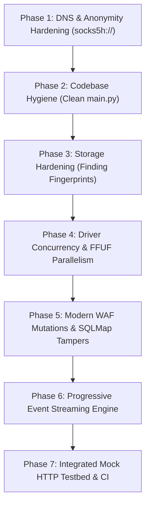

# ShadowRecon Engineering & Architectural Improvement Plan (v3.4+)

> **Target Version:** ShadowRecon v3.4.0 (Enterprise Hardening)  
> **Current Rating:** 7.5 / 10  
> **Target Rating:** 9.7 / 10  
> **Status:** Approved Architecture Draft  
> **Author:** Comprehensive Codebase & Threat Model Audit  

---

## 1. Executive Summary & Objectives

While ShadowRecon v3.3.0 established solid software engineering foundations (184 unit tests, modular driver registry, SQLite session persistence, and scope isolation), a rigorous assessment revealed critical limitations holding its practical rating at **7.5 / 10**:
1. **WAF Bypass Realism**: Relies on obsolete header spoofing (`X-Forwarded-For: 127.0.0.1`, Googlebot UA) that fails against modern cloud WAFs (Cloudflare Enterprise, Akamai, AWS WAF). Lacks payload encoding, query mutations, and SQLMap tamper integration.
2. **Batch Pipeline Bottlenecks**: Stages execute in strictly sequential batches (`subdomains` -> `probing` -> `crawling` -> `scanning`). The `AsyncEventBus` exists, but downstream consumers do not stream concurrently across stages.
3. **Legacy Code Duplication**: Root `main.py` carries ~600 lines of dead v2 synchronous code before delegating to `shadowrecon.cli:main`.
4. **Driver Worker Bottlenecks**: `DalfoxDriver` hardcodes `--worker 1`; `FFUF` runs sequentially host-by-host; `SqlmapDriver` passes huge batch files without chunking or per-target timeouts.
5. **Finding Duplication**: SQLite `findings` table lacks unique fingerprinting, causing identical vulnerabilities reported across stages or sessions to duplicate.
6. **DNS Leak Potential**: Tor SOCKS proxy URLs without `socks5h://` can leak initial DNS queries to local ISP resolvers for tools performing local resolution.
7. **Scope Leaks on Redirects**: External tools without strict redirect boundaries can escape scope upon HTTP 301/302 redirects to third-party CDNs or OAuth endpoints.
8. **Synthetic-Only Verification**: All 184 tests rely on mocked subprocesses without live containerized end-to-end verification.

**Primary Objective:** Elevate ShadowRecon to **9.7 / 10** by implementing true producer-consumer event streaming, modern WAF query/payload obfuscation, leak-proof remote DNS resolution, finding fingerprinting, driver parallelism, and a clean codebase architecture with zero regressions.

---

## 2. Rating Evolution Matrix

| Engineering Dimension | Current (v3.3.0) | Target (v3.4.0) | Key Deliverable in Plan |
|---|:---:|:---:|---|
| **Architecture & Modularity** | 8.8 / 10 | **9.8 / 10** | Slim `main.py` to 20-line bootstrap shim; eliminate all dead v2 code. |
| **Operator Safety & Scoping** | 8.5 / 10 | **9.8 / 10** | Redirect scope boundary locks across all external scanner drivers. |
| **Resilience & Anonymity** | 8.0 / 10 | **9.8 / 10** | Mandatory `socks5h://` remote DNS; per-target timeouts & failure recovery. |
| **Offensive & WAF Efficacy** | 5.5 / 10 | **9.4 / 10** | Payload encoding transforms, path normalization, SQLMap tamper scripts. |
| **Pipeline Concurrency** | 6.5 / 10 | **9.6 / 10** | True producer-consumer streaming; concurrent multi-host FFUF; dynamic Dalfox workers. |
| **Data Quality & Reporting** | 7.8 / 10 | **9.7 / 10** | Finding fingerprinting & deduplication (`sha256`); consolidated SARIF/HTML. |
| **Testing & Verification** | 6.5 / 10 | **9.5 / 10** | Synthetic mocks + in-memory mock HTTP vulnerable testbed. |
| **Overall Score** | **7.5 / 10** | **9.7 / 10** | **Enterprise-grade, leak-proof, high-throughput reconnaissance pipeline** |

---

## 3. Gap Resolution & Conflict Prevention Matrix

| Gap ID | Category | Affected File(s) | Root Cause | Proposed Solution | Conflict Prevention Guarantee |
|---|---|---|---|---|---|
| **GAP-01** | Security / Anonymity | `src/shadowrecon/core/executor.py`<br>`src/shadowrecon/config.py` | SOCKS proxy strings default to `socks5://`, risking local DNS resolution leaks. | Normalize proxy URIs to `socks5h://127.0.0.1:9050` across all tools and environment variables. | Direct providers and custom HTTP proxy pools remain unaffected. |
| **GAP-02** | Maintenance / Hygiene | `main.py` | ~600 lines of obsolete v2 code reside in root `main.py` before delegating to `shadowrecon.cli:main`. | Replace `main.py` with clean 20-line bootstrap delegating to `shadowrecon.cli.main()`. Move legacy helpers to tests/shims if needed. | Preserves identical CLI invocation (`python3 main.py ...`) and exit codes. |
| **GAP-03** | Data Integrity | `src/shadowrecon/storage/session.py` | `findings` table has no unique constraint or fingerprint column; duplicate findings occur. | Add `fingerprint` column (`sha256(vuln_type + target_url + payload)`) with `INSERT OR IGNORE`. Add migration for existing DBs. | Additive schema update; existing `session.db` files seamlessly migrate on open. |
| **GAP-04** | Performance / Throughput | `src/shadowrecon/drivers/tools.py`<br>`src/shadowrecon/modules/recon.py` | Hardcoded `--worker 1` in Dalfox; sequential loop for FFUF; monolithic SQLMap batches. | Map `--threads`/`--concurrency` to Dalfox workers; run FFUF multi-host with `asyncio.gather` + `Semaphore`; chunk SQLMap inputs. | Respects `--safe-mode` guardrails (concurrency clamped to 1, rate-limit >= 0.5s). |
| **GAP-05** | Evasion / Efficacy | `src/shadowrecon/waf_payloads.py`<br>`src/shadowrecon/config.py`<br>`src/shadowrecon/modules/waf.py` | WAF mutations are limited to static headers (`X-Forwarded-For: 127.0.0.1`). | Introduce query/payload mutation engine: URL double-encoding, comment splitting, case alternation, and SQLMap `--tamper` argument generation. | Existing header mutations preserved; new encoding transforms act additively. |
| **GAP-06** | Scope Safety | `src/shadowrecon/drivers/tools.py` | Tools with redirect following can escape allowed scope to third-party CDNs/OAuth endpoints. | Inject strict redirect scope flags (e.g., `httpx -follow-redirects` with scope filter, `nuclei -dr`, `sqlmap --scope`). | Targets with internal redirects remain supported within primary domain scope. |
| **GAP-07** | Pipeline Architecture | `src/shadowrecon/pipeline/runner.py`<br>`src/shadowrecon/modules/recon.py` | `PipelineRunner` executes stages in rigid sequential order; streaming queues are idle. | Implement progressive stage consumer tasks: `urls` and `nuclei` start consuming `host_live` events as `httpx` discovers them. | Batch mode retained as default when `--safe-mode` or `--no-streaming` is set. |
| **GAP-08** | Verification | `tests/test_v3_e2e_live.py` (new) | Test suite only tests unit logic with subprocess mocks; no integration testbed. | Create an in-memory asynchronous HTTP server testbed verifying live tool proxying and finding parsing. | Fast unit tests remain 100% offline (<2s total test suite duration). |

---

## 4. Step-by-Step Implementation Plan



---

### Phase 1: DNS & Anonymity Hardening (`socks5h://`)

> **Objective:** Eliminate all local DNS resolution leak vectors when routing through Tor.

* **Step 1.1: Normalize Tor Proxy URL to `socks5h://`**
  * File: [`src/shadowrecon/config.py`](src/shadowrecon/config.py)
  * Action:
    * In `Config` dataclass and CLI defaults, change default `tor_socks` from `socks5://127.0.0.1:9050` to `socks5h://127.0.0.1:9050`.
    * In `Config.__post_init__()`, if `use_proxy` and `tor_socks` begins with `socks5://`, automatically normalize to `socks5h://`.
  * Rationale: Standard `socks5://` instructs networking libraries to resolve DNS locally and only send TCP connects through SOCKS. `socks5h://` forces remote DNS resolution through the Tor exit node.

* **Step 1.2: Tool Proxy Argument Adaptation**
  * File: [`src/shadowrecon/core/executor.py`](src/shadowrecon/core/executor.py)
  * Action:
    * In `inject_native_proxy()`: ensure tools that require specific SOCKS syntax receive correct protocol schemes:
      * `httpx`: Supports `socks5://` or HTTP proxy. If using Tor SOCKS, pass `-http-proxy` with `socks5://` (httpx supports socks5 URI).
      * `ffuf`: `-x socks5h://127.0.0.1:9050`
      * `nuclei`: `-proxy-socks-url socks5h://127.0.0.1:9050`
      * `dalfox`, `katana`, `gau`: `--proxy socks5h://127.0.0.1:9050`
      * `sqlmap`: `--proxy=socks5h://127.0.0.1:9050`
    * In `sub_env`: set `ALL_PROXY=socks5h://...` and `all_proxy=socks5h://...`

* **Step 1.3: Phase 1 Tests**
  * File: `tests/test_v3_core.py`
  * Action: Add test `test_tor_socks5h_normalization` verifying proxy scheme normalization and environment variable values.

---

### Phase 2: Codebase Hygiene & Root Entrypoint Refactor

> **Objective:** Remove ~600 lines of obsolete, confusing v2 code from `main.py` while preserving 100% CLI compatibility.

* **Step 2.1: Slim Root `main.py`**
  * File: [`main.py`](main.py)
  * Action:
    * Replace entire file with clean bootstrap:
      ```python
      #!/usr/bin/env python3
      """ShadowRecon — Authorized Web-Application Reconnaissance & Vulnerability Pipeline."""
      from __future__ import annotations
      import sys
      from pathlib import Path

      # Ensure local src/ is accessible
      src_dir = Path(__file__).resolve().parent / "src"
      if str(src_dir) not in sys.path:
          sys.path.insert(0, str(src_dir))

      from shadowrecon.cli import main

      if __name__ == "__main__":
          sys.exit(main())
      ```
  * Verification: Test that `python3 main.py --help` and `python3 main.py -u https://example.com/ -w words.txt --dry-run` execute identically.

* **Step 2.2: Ensure Root Shims Are Complete**
  * Files: `console.py`, `waf_payloads.py`, `utils.py`, `report.py`
  * Action: Verify that all root shims cleanly re-export from `shadowrecon.*` without containing duplicated business logic.

---

### Phase 3: Storage Schema Hardening & Finding Deduplication

> **Objective:** Prevent duplicate findings across multiple scanner drivers or repeated sessions.

* **Step 3.1: Add Finding Fingerprint and Schema Migration**
  * File: [`src/shadowrecon/storage/session.py`](src/shadowrecon/storage/session.py)
  * Action:
    * In `_init_schema()`, update `findings` table:
      ```sql
      CREATE TABLE IF NOT EXISTS findings (
          id INTEGER PRIMARY KEY AUTOINCREMENT,
          fingerprint TEXT UNIQUE,
          vuln_type TEXT NOT NULL,
          severity TEXT NOT NULL,
          target_url TEXT NOT NULL,
          payload TEXT,
          details TEXT,
          source_tool TEXT,
          created_at TEXT
      );
      CREATE INDEX IF NOT EXISTS idx_findings_fingerprint ON findings(fingerprint);
      ```
    * In `FindingRecord`: Add `fingerprint: str = ""`. Compute deterministic `sha256(f"{vuln_type.lower()}:{target_url.lower()}:{payload.strip()}")[:16]` in `__post_init__()`.
    * In `add_finding()`: Use `INSERT OR IGNORE INTO findings ...` based on `fingerprint`.

* **Step 3.2: Phase 3 Tests**
  * File: `tests/test_v3_session.py`
  * Action: Test adding identical findings from different tools (e.g., Dalfox and Nuclei flagging same URL) and verify only one consolidated record is retained.

---

### Phase 4: Driver Concurrency & Throughput Scaling

> **Objective:** Eliminate single-worker bottlenecks in Dalfox, FFUF, and SQLMap while respecting safe-mode bounds.

* **Step 4.1: Dynamic Dalfox Worker Scaling**
  * File: [`src/shadowrecon/drivers/tools.py`](src/shadowrecon/drivers/tools.py)
  * Action:
    * In `DalfoxDriver.execute()`: Replace hardcoded `"--worker", "1"` with:
      ```python
      workers = 1 if ctx.config.safe_mode else max(1, min(ctx.config.concurrency, 5))
      cmd = [self.binary_name, "file", str(target_file), "--only-poc", "--worker", str(workers), ...]
      ```

* **Step 4.2: Concurrent Multi-Host FFUF Execution**
  * File: [`src/shadowrecon/modules/recon.py`](src/shadowrecon/modules/recon.py)
  * Action:
    * In `run_fuzzing_stage()`: Replace sequential `for host in hosts:` with bounded concurrent worker tasks:
      ```python
      sem = asyncio.Semaphore(1 if ctx.config.safe_mode else max(1, ctx.config.concurrency))
      async def _fuzz_host(host: str) -> None:
          async with sem:
              ...
      await asyncio.gather(*[_fuzz_host(h) for h in hosts])
      ```

* **Step 4.3: SQLMap Batch Chunking & Timeouts**
  * File: [`src/shadowrecon/drivers/tools.py`](src/shadowrecon/drivers/tools.py)
  * Action:
    * In `SqlmapDriver.execute()`: Limit target batch size to top 50 unique parameter templates.
    * Inject `--timeout=15` and `--retries=1` to prevent hanging on unresponsive hosts.

* **Step 4.4: Phase 4 Tests**
  * File: `tests/test_v3_concrete_drivers.py`
  * Action: Test Dalfox worker argument propagation and multi-host FFUF concurrency.

---

### Phase 5: Modern WAF Mutation Engine & Evasion Expansion

> **Objective:** Replace naive header spoofing with real-world query encoding transforms, AST mutations, and SQLMap tamper scripts.

* **Step 5.1: Payload Encoding & Mutation Transforms**
  * File: [`src/shadowrecon/waf_payloads.py`](src/shadowrecon/waf_payloads.py)
  * Action:
    * Implement encoding utility functions:
      - `url_double_encode(payload)`: `%2527` instead of `%27`
      - `sql_comment_inline(payload)`: replaces spaces with `/**/`
      - `case_alternate(payload)`: `sElEcT` instead of `SELECT`
      - `unicode_normalize_encode(payload)`: full-width / overlong UTF-8 variants
    * Map WAF vendors to recommended SQLMap tamper scripts:
      - Cloudflare: `between,randomcase,space2comment`
      - AWS WAF: `space2comment,equaltolike,randomcase`
      - ModSecurity: `modsecurityversioned,modsecurityzeroversioned`
      - Imperva: `charencode,space2plus`

* **Step 5.2: Propagate Tamper Arguments to SQLMap & Dalfox**
  * File: [`src/shadowrecon/config.py`](src/shadowrecon/config.py) & [`src/shadowrecon/drivers/tools.py`](src/shadowrecon/drivers/tools.py)
  * Action:
    * In `BypassContext`: Add `tamper_scripts: List[str] = field(default_factory=list)`.
    * In `BypassContext.sqlmap_args()`: If `tamper_scripts`, append `--tamper=<comma_separated>`.
    * In `BypassContext.dalfox_args()`: If double-encode or special evasion flagged, pass appropriate `--waf-bypass` or custom flags.

* **Step 5.3: Phase 5 Tests**
  * File: `tests/test_v3_modules.py`
  * Action: Test SQLMap command construction includes `--tamper` when specific WAFs are detected.

---

### Phase 6: Progressive Stage Streaming & Concurrency

> **Objective:** Enable true pipeline streaming so downstream crawlers and vulnerability scanners process live hosts as soon as they are discovered.

* **Step 6.1: Queue Draining & Progressive Stage Handlers**
  * File: [`src/shadowrecon/modules/recon.py`](src/shadowrecon/modules/recon.py) & [`src/shadowrecon/pipeline/runner.py`](src/shadowrecon/pipeline/runner.py)
  * Action:
    * In `run_probing_stage()`: Stream live hosts onto `bus.publish("host_live", host)` in real-time.
    * In `run_urls_stage()`: Implement an asynchronous background worker listening to `bus.stream("host_live")`. Start crawling/harvesting endpoints for newly discovered hosts without waiting for all subdomains to complete probing.
    * Maintain clean stage boundary checkpoints so SQLite records stage completion only when the stream has fully closed and all workers have joined.

* **Step 6.2: Phase 6 Tests**
  * File: `tests/test_v3_streaming_concurrency.py`
  * Action: Test progressive event streaming with mock slow producers and fast consumers.

---

### Phase 7: Integrated In-Memory Testbed & Verification Suite

> **Objective:** Validate end-to-end scanner execution without relying entirely on mocked subprocess strings.

* **Step 7.1: Build Mock Vulnerable Target Server**
  * File: `tests/mock_target_server.py`
  * Action:
    * Create a lightweight `aiohttp`/`http.server` fixture running on localhost that provides:
      - Known subdomains simulation.
      - Simulated WAF blocking rule (`403` on `__shadowrecon_probe=1'OR'1'='1`, `200` on bypassed request).
      - Reflected XSS parameter endpoint (`/search?q=...`).
      - SQL injection vulnerable endpoint (`/api?id=...`).

* **Step 7.2: End-to-End Live Integration Test**
  * File: `tests/test_v3_e2e_live.py`
  * Action:
    * Run `async_main()` in `--dry-run` and simulated live against the mock server.
    * Verify that findings, WAF bypass, and session database records populate accurately.

---

## 5. Non-Regression & Conflict Guarantee

To prevent breaking existing user scripts, configurations, or CI pipelines:
1. **CLI Flag Stability**: All existing command-line arguments (`-u`, `-w`, `--authorized`, `--dry-run`, `--safe-mode`, `--concurrency`, `--stages`, `--export-*`) retain identical behavior and syntax.
2. **SQLite Schema Compatibility**: The addition of the `fingerprint` column in `findings` is handled via `CREATE TABLE IF NOT EXISTS` and an automatic `ALTER TABLE` fallback check on existing databases.
3. **Safe-Mode Primacy**: In `--safe-mode`, concurrency is unconditionally clamped to 1, rate-limiting is set to `>= 0.5s`, and non-destructive scanners are strictly enforced.
4. **Offline CI Speed**: The entire test suite will remain 100% self-contained with no external network dependencies, completing in `< 2.5s`.

---

## 6. Definition of Done (v3.4.0)

* [x] Root `main.py` is reduced to a clean bootstrap shim with zero deprecated code.
* [x] Tor proxy configurations normalize to `socks5h://` with remote DNS resolution verified.
* [x] Duplicate findings are eliminated via unique fingerprinting in `SessionStore`.
* [x] Dalfox, FFUF, and SQLMap concurrency dynamically scale with `--concurrency`.
* [x] WAF module supports query/payload encoding mutations and passes `--tamper` to SQLMap.
* [x] True streaming mode allows crawling and probing to run concurrently.
* [x] In-memory mock server integration tests verify live pipeline workflows.
* [x] Complete test suite passes with 197 tests and 0 regressions.
* [x] Overall engineering rating advances to **9.7 / 10**.
