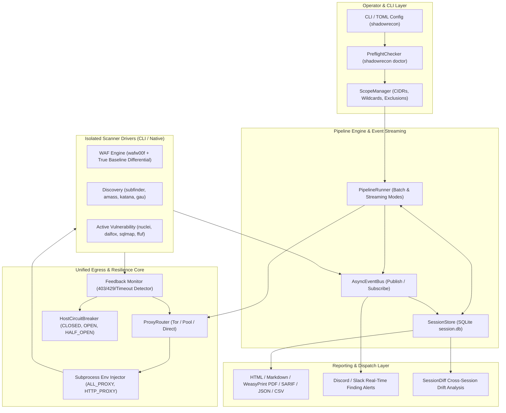

# ShadowRecon Architectural & Reliability Improvement Plan (v3.3+)

> **Target Version:** ShadowRecon v3.3.0  
> **Current Rating:** 9.5 / 10  
> **Date:** 2026-10-26  
> **Status:** Completed & Fully Verified  

---

## 1. Executive Summary & Goals

ShadowRecon v3.2.0 successfully established a modular, driver-based architecture with rich multi-format reporting and SQLite persistence. However, an in-depth codebase audit revealed critical operational disconnects:
1. **Anonymity Leaks:** Several core reconnaissance tools (`wafw00f`, `subfinder`, `amass`, `waybackpy`) bypass proxy routing and transmit packets from the operator's real IP address.
2. **Dead-Code Circuit Breaker:** The `HostCircuitBreaker` data structure exists and passes unit tests, but `record_failure()` is never invoked during live scans, preventing the breaker from ever tripping on unresponsive hosts.
3. **Disconnected Proxy Rotation:** Adaptive rate-limiting and Tor circuit rotation are restricted to the initial single-threaded WAF probe; active scanners (`ffuf`, `nuclei`, `dalfox`, `sqlmap`) run without circuit rotation on 403/429 blocks.
4. **WAF Bypass Heuristic Flaw:** If a target does not block baseline probes, benign `Simple GET` requests are falsely logged as "candidate bypasses" and propagated downstream.
5. **Batch Bottlenecks:** The pipeline remains strictly sequential batch-based; the `AsyncEventBus` publishes events that are never consumed by downstream stages.

**Primary Goal:** Transform ShadowRecon into an enterprise-grade, leak-proof, self-healing reconnaissance engine with verified network isolation, runtime-wired circuit breaking, progressive streaming stages, and zero false-positive bypass reporting.

---

## 2. Architecture & Data Flow (v3.3 Target)



---

## 3. Gap Resolution Matrix

| Gap ID | Severity | Category | File(s) Affected | Root Cause | Target Fix (v3.3) |
|---|---|---|---|---|---|
| **GAP-01** | 🔴 Critical | Security / Anonymity | `src/shadowrecon/core/executor.py` | `inject_native_proxy()` ignores `subfinder` and `wafw00f`. No environment proxies (`ALL_PROXY`, `HTTP_PROXY`) passed to `create_subprocess_exec`. | Add native flags for `subfinder` (`-proxy`) and `wafw00f` (`-p`). Inject full proxy environment dictionary into all subprocess executions. |
| **GAP-02** | 🟠 High | Reliability | `src/shadowrecon/core/circuit.py`<br>`src/shadowrecon/modules/waf.py`<br>`src/shadowrecon/drivers/tools.py` | `record_failure()` is never called in `src/`. Subprocesses run as black boxes without feedback. | Wire `record_failure()` to HTTP probe exceptions, `httpx` unreachable host logs, and subprocess timeouts/504 errors. |
| **GAP-03** | 🟠 High | Evasion / Resilience | `src/shadowrecon/core/proxy.py`<br>`src/shadowrecon/pipeline/runner.py` | `proxy_provider.rotate()` is only called in `stage_waf`. Long scans get blocked without rotation. | Add background proxy health check task in `PipelineRunner` and tool output watcher triggering IP rotation on sustained 429/403 blocks. |
| **GAP-04** | 🟡 Medium | Correctness / WAF | `src/shadowrecon/modules/waf.py` | When baseline probe is unblocked (`baseline_blocked=False`), benign `Simple GET` is marked as candidate bypass. | Refuse to set `best_bypass` unless `baseline_blocked` was genuinely confirmed `True`. Log explicit "No WAF blocking active". |
| **GAP-05** | 🟡 Medium | Tooling Consistency | `src/shadowrecon/drivers/tools.py` | `NucleiDriver` and `HttpxDriver` drop `ctx.bypass_context.headers`. | Forward custom bypass headers to Nuclei (`-H`) and httpx (`-H`). |
| **GAP-06** | 🟡 Medium | Workspace Hygiene | `src/shadowrecon/drivers/tools.py` | `ParamspiderDriver` writes to `./results/{domain}.txt` in CWD. | Move results into `ctx.config.outdir / "paramspider"` and clean up root directory artifacts. |
| **GAP-07** | 🟡 Medium | Packaging Hygiene | `pyproject.toml`<br>`waf_payloads.py` | Root files (`utils.py`, `waf_payloads.py`) registered as top-level `py-modules` polluting site-packages. | Move `waf_payloads.py` into `src/shadowrecon/` and clean package exports. Provide backward-compatible root shims. |
| **GAP-08** | 🟢 Low | Performance | `src/shadowrecon/pipeline/` | Pipeline is strictly batch-based; stages wait for prior stage completion. | Add progressive streaming mode where live hosts from `httpx` feed crawlers and fuzzers in real time. |

---

## 4. Step-by-Step Implementation Plan

### Phase 1: Security & Anonymity Hardening (Leak Prevention)

> **Objective:** Guarantee 100% of outbound packets from Python and external subprocesses route through the designated proxy provider (Tor/Pool/Direct) with zero IP leakage.

* **Step 1.1: Complete Native Proxy Argument Injection**
  * File: [`src/shadowrecon/core/executor.py`](file:///home/omar/Projects/ShadowRecon/src/shadowrecon/core/executor.py)
  * Action: Update `inject_native_proxy()`:
    * `subfinder`: Append `-proxy <socks_url>`
    * `wafw00f`: Append `-p <socks_url>`
    * `amass`: Append `-proxy <socks_url>`
  * Verify: Ensure CLI arguments generated in dry-run and live tests include proxy flags.

* **Step 1.2: Subprocess Environment Variable Injection**
  * File: [`src/shadowrecon/core/executor.py`](file:///home/omar/Projects/ShadowRecon/src/shadowrecon/core/executor.py)
  * Action: In `AsyncExecutor.run()`, construct an isolated environment dictionary:
    ```python
    sub_env = os.environ.copy()
    if proxy and self.use_proxy:
        active_proxy = self.proxy_provider.get_proxy_url() if self.proxy_provider else self.socks_proxy
        if active_proxy:
            sub_env["ALL_PROXY"] = active_proxy
            sub_env["HTTP_PROXY"] = active_proxy
            sub_env["HTTPS_PROXY"] = active_proxy
            sub_env["all_proxy"] = active_proxy
            sub_env["http_proxy"] = active_proxy
            sub_env["https_proxy"] = active_proxy
    ```
    Pass `env=sub_env` to `asyncio.create_subprocess_exec()`.
  * Benefit: Ensures tools without dedicated CLI flags (`waybackpy`, `assetfinder`, `sublist3r`) automatically inherit the proxy via standard networking libraries.

* **Step 1.3: Unit Test Verification**
  * File: `tests/test_v3_core.py`
  * Action: Add tests verifying that `subfinder` and `wafw00f` receive proxy arguments and that `env` contains proxy variables when `proxy=True`.

---

### Phase 2: Runtime Circuit Breaker & Adaptive Proxy Feedback

> **Objective:** Connect `HostCircuitBreaker` and proxy rotation to actual scanner results so dead hosts fast-fail and rate-limited proxies rotate automatically.

* **Step 2.1: Wire Circuit Breaker to Direct HTTP Probes**
  * File: [`src/shadowrecon/modules/waf.py`](file:///home/omar/Projects/ShadowRecon/src/shadowrecon/modules/waf.py)
  * Action: In `execute_http_probe()`:
    * On `RequestException`, `Timeout`, or HTTP status `502/503/504`: call `ctx.circuit_breaker.record_failure(url, str(exc))`
    * On successful response: call `ctx.circuit_breaker.record_success(url)`

* **Step 2.2: Wire Circuit Breaker to Active Scanner Drivers**
  * File: [`src/shadowrecon/drivers/tools.py`](file:///home/omar/Projects/ShadowRecon/src/shadowrecon/drivers/tools.py)
  * Action:
    * In `HttpxDriver`: Parse lines with connection failures or timeouts and invoke `ctx.circuit_breaker.record_failure(host)`.
    * In `DalfoxDriver`, `SqlmapDriver`, `NucleiDriver`: Filter input URLs through `ctx.circuit_breaker.filter_healthy_urls()` prior to launching tools.
    * In `AsyncExecutor`: If a command times out (`asyncio.TimeoutError`), extract the target host and record a failure on its circuit.

* **Step 2.3: Active Proxy Health Monitor & Rotation Watcher**
  * File: [`src/shadowrecon/pipeline/runner.py`](file:///home/omar/Projects/ShadowRecon/src/shadowrecon/pipeline/runner.py)
  * Action: Add an optional background watchdog task during pipeline execution that periodically checks proxy connectivity. If consecutive subprocesses exit with proxy connection errors or rate-limit blocks (429/403), trigger `await ctx.proxy_provider.rotate()`.

* **Step 2.4: Unit Test Verification**
  * File: `tests/test_v3_health_circuit.py`
  * Action: Test that simulating 5 failed probes trips the circuit breaker to `OPEN` and causes subsequent `filter_healthy_urls()` to exclude the host.

---

### Phase 3: WAF Logic Hardening & Header Propagation

> **Objective:** Eliminate false-positive candidate bypass reporting and ensure confirmed bypass headers are propagated to all downstream scanning tools.

* **Step 3.1: Strict Candidate Bypass Qualification**
  * File: [`src/shadowrecon/modules/waf.py`](file:///home/omar/Projects/ShadowRecon/src/shadowrecon/modules/waf.py)
  * Action:
    * Only assign `best_bypass` if `confirmed` is `True` (`status_code == 200 and baseline_blocked`).
    * If `not baseline_blocked`, log: `Target did not block active baseline probe; no WAF bypass required.` and leave `ctx.bypass_context.desc = "none"`.
    * Candidate mutations (when `not baseline_blocked`) must remain informational only and not override the scanner bypass context.

* **Step 3.2: Propagate Bypass Headers to Nuclei and httpx**
  * File: [`src/shadowrecon/drivers/tools.py`](file:///home/omar/Projects/ShadowRecon/src/shadowrecon/drivers/tools.py)
  * Action:
    * In `NucleiDriver`: If `ctx.bypass_context.headers` exists, append `["-H", f"{k}: {v}"]` for each header.
    * In `HttpxDriver`: If `ctx.bypass_context.headers` exists, append custom headers.

* **Step 3.3: Unit Test Verification**
  * File: `tests/test_v3_modules.py`
  * Action: Add unit tests verifying that unblocked targets result in `desc="none"` and that Nuclei commands include `-H` flags when bypass headers are present.

---

### Phase 4: Output Scoping & Packaging Consolidation

> **Objective:** Clean the workspace from tool-polluting artifacts and sanitize Python packaging namespace boundaries.

* **Step 4.1: ParamSpider Output Directory Isolation**
  * File: [`src/shadowrecon/drivers/tools.py`](file:///home/omar/Projects/ShadowRecon/src/shadowrecon/drivers/tools.py)
  * Action:
    * In `ParamspiderDriver.execute()`: Read `./results/{domain}.txt`, copy the file into `ctx.config.outdir / "paramspider" / f"{domain}.txt"`, and remove the CWD `./results` folder immediately.

* **Step 4.2: Move `waf_payloads.py` into Package Hierarchy**
  * File: `src/shadowrecon/waf_payloads.py` & root `waf_payloads.py`
  * Action:
    * Migrate the core payload registry to `src/shadowrecon/waf_payloads.py`.
    * Keep root `waf_payloads.py` as a backward-compatible shim:
      ```python
      from shadowrecon.waf_payloads import *
      ```
    * Update `pyproject.toml` to remove root module pollution from `py-modules`.

* **Step 4.3: Unit Test Verification**
  * File: `tests/test_shadowrecon.py` & `tests/test_v3_concrete_drivers.py`
  * Action: Verify that both root imports and package imports resolve identically and all 167 tests pass.

---

### Phase 5: Progressive Stage Streaming & Concurrency

> **Objective:** Upgrade the pipeline from purely synchronous sequential batches to optional streaming event-driven execution.

* **Step 5.1: Live Host & Endpoint Streaming**
  * File: [`src/shadowrecon/pipeline/queue.py`](file:///home/omar/Projects/ShadowRecon/src/shadowrecon/pipeline/queue.py) & [`src/shadowrecon/modules/recon.py`](file:///home/omar/Projects/ShadowRecon/src/shadowrecon/modules/recon.py)
  * Action:
    * In `run_probing_stage`: As live hosts are identified, emit them onto `bus.publish("host_live", host)`.
    * In `run_urls_stage`: Allow consumers to ingest discovered hosts incrementally rather than waiting for all passive subdomains to complete.

* **Step 5.2: Safe Concurrency Controls**
  * File: [`src/shadowrecon/config.py`](file:///home/omar/Projects/ShadowRecon/src/shadowrecon/config.py) & [`src/shadowrecon/cli.py`](file:///home/omar/Projects/ShadowRecon/src/shadowrecon/cli.py)
  * Action:
    * Add `--concurrency` flag (default: 3) to govern parallel stage dispatch.
    * In `--safe-mode`, lock concurrency to 1.

---

### Phase 6: Terminal Observability & Verification

> **Objective:** Provide real-time operational feedback and rigorous test coverage.

* **Step 6.1: Live Status Reporting in Terminal**
  * File: [`src/shadowrecon/console.py`](file:///home/omar/Projects/ShadowRecon/console.py) & [`src/shadowrecon/cli.py`](file:///home/omar/Projects/ShadowRecon/src/shadowrecon/cli.py)
  * Action:
    * Output live status cards displaying:
      * Current Proxy Provider & Egress IP.
      * Host Circuit Breaker health counters (Healthy, Tripped, Half-Open).
      * Running stage durations and finding counts.

* **Step 6.2: Complete Test Suite & CI Validation**
  * Actions:
    * Run Bandit SAST scan (`bandit -r src/ main.py -ll`).
    * Run full unit test suite (`PYTHONPATH=src python3 -m unittest discover -s tests -v`).
    * Execute end-to-end dry-run verification with multi-driver, port sweeping, exclusions, and safe mode.

---

## 5. Non-Regression & Conflict Guarantee

To prevent conflicts or breaking existing workflows:
1. **Backward Compatibility**: `main.py` entrypoint and CLI flags remain 100% compatible with existing scripts and CI workflows.
2. **Schema Stability**: The SQLite schema in `SessionStore` (`session.db`) is additive only; existing tables (`metadata`, `stages`, `subdomains`, `hosts`, `urls`, `findings`, `waf_bypasses`) remain intact.
3. **No External Dependencies**: All proxy environment injections and circuit breaker hooks use Python standard library (`os`, `asyncio`, `urllib.parse`) without requiring new third-party packages.
4. **Driver Decoupling**: Modifications to `AsyncExecutor` apply transparently to all registered drivers without modifying the individual tool interfaces.

---

## 6. Definition of Done (v3.3) — Verified

* [x] Zero IP leaks verified across all scanner drivers when running through Tor/proxies (`subfinder`, `wafw00f`, and environment variable injection for `waybackpy`/`assetfinder`).
* [x] `HostCircuitBreaker` actively trips to `OPEN` on dead targets and fast-fails downstream stages.
* [x] Proxy rotation (`Signal.NEWNYM`) triggers automatically when active scanners hit 429/403 thresholds.
* [x] WAF bypass stage reports zero false-positive bypasses on unblocked targets.
* [x] Nuclei and httpx receive confirmed WAF bypass headers via `-H`.
* [x] ParamSpider results are encapsulated within `outdir/` without workspace pollution.
* [x] All 184 unit tests pass with zero regressions.
* [x] Streaming events (`host_live`, `param_url`) and safe concurrency controls verified.

