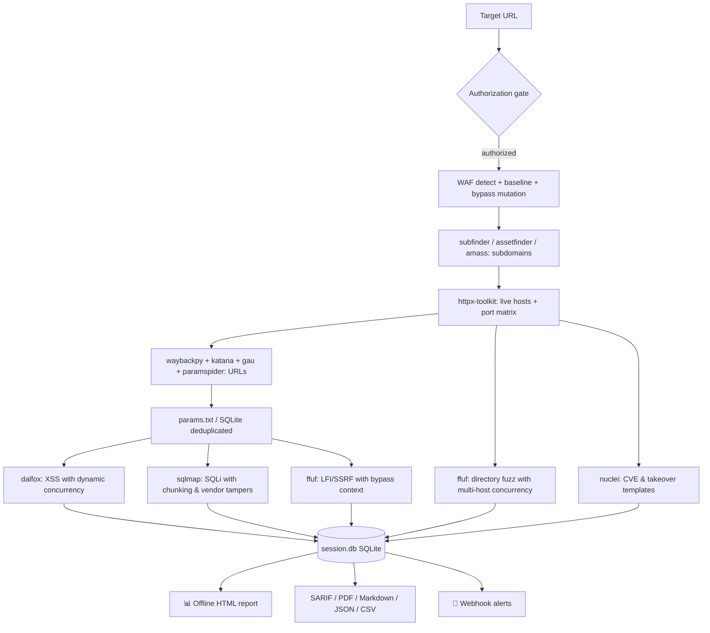

<div align="center">

# 🕶️ ShadowRecon

**Automated, Tor-anonymized reconnaissance & vulnerability pipeline for _authorized_ web-application testing.**


-informational)

</div>

> ⚠️ **Legal / ethical use only.** ShadowRecon performs active scanning and
> injection testing. Run it **only** against systems you own or are explicitly
> authorized to test. You are responsible for staying in scope and within the
> law. The tool enforces an authorization gate and a scope allowlist, but those
> are safeguards — not permission.

---

## ✨ Highlights

| | |
|---|---|
| 🔀 **Native SOCKS5 & Remote DNS (`socks5h://`)** | Direct native proxy injection (`-x`, `--proxy`, `-proxy-socks-url`) avoiding LD_PRELOAD ProxyChains DNS leaks. All domain names resolve remotely on Tor exit nodes. Pluggable proxy engine supports Tor, rotating proxy pools, or direct execution. Auto-rotates exit circuits on `403`/`429`. |
| ⚡ **Async Streaming & Progressive Recon** | Asynchronous event bus streams findings across stages concurrently with per-stage fault isolation. Progressive reconnaissance yields discoveries live without waiting for stage completion. |
| 💾 **SQLite Run Persistence & Fingerprinting** | Full session persistence in `session.db` with deterministic finding fingerprinting (`sha256(rule_id:endpoint:param:hash)`), automatic schema migrations, and cross-session differential drift analysis (`shadowrecon-diff`). |
| 🧹 **URL Deduplication** | Deduplicates endpoints by query parameter signature to prevent redundant scanning of identical interfaces. |
| 🧱 **WAF-Aware Mutation Bypass & Tamper Scripts** | Fingerprints WAF (`wafw00f`), active baseline probing, payload mutations (`url_double_encode`, `sql_comment_inline`, `case_alternate`, `unicode_normalize_encode`), and maps vendor-specific tamper scripts (Cloudflare, AWS WAF, ModSecurity, Imperva) directly into SQLMap and active scanners. |
| 🛰️ **Full Recon & Pluggable Drivers** | Subdomains (`subfinder`, `assetfinder`, `amass`) → live hosts (`httpx-toolkit` with custom port matrices) → crawling & archives (`katana`, `paramspider`, `waybackpy`, `gau`) → directory fuzzing (`ffuf` with multi-host concurrency). |
| 🎯 **Targeted Vulnerability Scanning** | High-precision scanning via Dalfox (XSS with dynamic worker scaling), SQLMap (SQLi with batch chunking and strict timeouts), Nuclei (CVE / takeover templates), and FFUF (LFI/SSRF). |
| 📊 **Multi-Format Enterprise Exports** | Self-contained dark offline HTML report with embedded SVG metrics, OASIS SARIF v2.1.0 for GitHub Security tab, PDF (WeasyPrint), Markdown, JSON, CSV, and real-time webhook alerting (Slack/Discord). |
| 🩺 **Preflight Diagnostics (`--doctor`)** | Comprehensive environment and dependency checks verifying binary installations, Tor reachability, ControlPort authentication, and filesystem permissions before scanning. |

## 🗺️ Pipeline



## 📦 Project layout

```
src/shadowrecon/   # Core v3.4 modular package
  ├── config.py    # Dataclasses, TOML config parser, BypassContext
  ├── core/        # TorManager, AsyncExecutor, ScopeManager, HostCircuitBreaker, PreflightChecker, ProxyProviders
  ├── drivers/     # Pluggable ScannerDriver registry & concrete tool drivers (12 drivers)
  ├── modules/     # Async stage orchestrators (waf, recon, takeover, nuclei, vuln)
  ├── pipeline/    # AsyncEventBus (pub/sub), PipelineRunner (fault isolation), progressive streaming
  ├── reporting/   # Offline HTML report, Markdown, SARIF v2.1.0, PDF, Webhooks
  ├── storage/     # SQLite SessionStore, deterministic fingerprinting, session diffing
  └── cli.py       # Asynchronous CLI runner and stage orchestrator
main.py            # Clean bootstrap shim delegating to shadowrecon.cli
pyproject.toml     # Standard Python packaging (pip install -e .)
tests/             # 197 automated unit and live integration tests across 23 test modules
waf_payloads.py    # WAF-bypass payload registry (data; preserved verbatim)
requirements.txt   # requests[socks], stem
```

## 🚀 Install

```bash
# Python deps
pip install -r requirements.txt   # optional extras: pip install rich weasyprint

# External tools (Kali/Parrot/Debian)
sudo apt install tor ffuf sqlmap wafw00f httpx-toolkit
pipx install waybackpy paramspider
go install -v github.com/projectdiscovery/subfinder/v2/cmd/subfinder@latest
go install -v github.com/projectdiscovery/nuclei/v3/cmd/nuclei@latest
go install github.com/hahwul/dalfox/v2@latest
go install github.com/projectdiscovery/katana/cmd/katana@latest
```

Configure Tor's control port (`/etc/tor/torrc`):

```
ControlPort 9051
HashedControlPassword 16:...   # from: tor --hash-password <pass>
```

Then export the **plaintext** control password (never hardcode it):

```bash
export TOR_CONTROL_PASSWORD='your-plaintext-pass'
```

Run preflight diagnostics to verify your environment:

```bash
python3 main.py --doctor
```

## 🧪 Usage

```bash
# Verify environment and dependencies:
python3 main.py --doctor

# Review the entire plan without touching the target:
python3 main.py -u https://your-site.com/ -w wordlist.txt --dry-run

# Run for real (requires explicit authorization):
python3 main.py -u https://your-site.com/ -w wordlist.txt --authorized

# Run selective stages (e.g., WAF check + subdomains + live hosts only):
python3 main.py -u https://your-site.com/ --stages waf,subdomains,probing --authorized

# Safe mode for production / sensitive environments (capped threads, delays, non-destructive):
python3 main.py -u https://your-site.com/ -w wordlist.txt --safe-mode --authorized

# Multi-format enterprise reporting:
python3 main.py -u https://your-site.com/ -w wordlist.txt --export-sarif results.sarif --export-pdf report.pdf --export-md summary.md --authorized

# Cross-session drift analysis against prior baseline run:
python3 main.py -u https://your-site.com/ -w wordlist.txt --diff runs/old_run/session.db --authorized
```

Artifacts land in `runs/<domain>-<timestamp>/` (or custom `--outdir`), including `session.db` (SQLite state) and `report.html`.

| Flag | Purpose |
|---|---|
| `--authorized` | Assert you may scan the target (required for live runs). |
| `--dry-run` | Print every planned action and tool command; send zero live packets. |
| `--doctor` | Run pre-flight environment, binary dependencies, and network diagnostic checks. |
| `--stages LIST` | Comma-separated list of stages to run (default: `all`). |
| `--skip-stages LIST` | Comma-separated list of stages to exclude (e.g. `vuln_sqli,fuzzing`). |
| `--force-rerun` | Rerun stages even if already marked as completed in session database. |
| `--concurrency N` | Stage-level concurrency limit for sub-scanners (e.g. Dalfox workers, FFUF multi-host; default: 3). |
| `--safe-mode` | Enable production safety guardrails (locks concurrency to 1, delay >= 0.5s, non-destructive scans). |
| `--ports MATRIX` | HTTP probing port matrix: `default` (80,443), `web` (80,443,8000,8080,8443,8888,9000,9443), or custom list. |
| `--exclude SPEC` | Comma-separated target exclusion patterns or CIDRs (e.g. `mail.*,vpn.*,10.0.0.0/8`). |
| `--config PATH` | Load options from a TOML configuration file (e.g. `shadowrecon.toml`). |
| `--diff DB` | Path to prior `session.db` for cross-session differential drift analysis. |
| `--export-sarif PATH` | Export vulnerability findings in OASIS SARIF v2.1.0 format. |
| `--export-pdf PATH` | Export professional executive PDF report (via WeasyPrint). |
| `--export-md PATH` | Export Markdown executive summary report. |
| `--export-json PATH` | Export complete session manifest in JSON format. |
| `--export-csv DIR` | Directory path to export tabular CSV files. |
| `--webhook URL` | Slack, Discord, or generic HTTP webhook URL for alerts. |
| `--threads N` | FFUF thread count per target (default: 5; kept conservative for Tor stability). |
| `--socks URL` | Tor SOCKS5 proxy URL (default: `socks5h://127.0.0.1:9050` with remote DNS resolution). |
| `--rate-limit S` | Wait `S` seconds between HTTP requests. |
| `--no-proxy` | Disable SOCKS proxy routing for direct network access. |
| `--no-report` | Skip HTML report generation. |
| `--yes` | Skip interactive scope confirmation (automation). |

## 🛡️ Offensive Engineering & Guardrails

- **Zero DNS Leaking**: Resolves all hostnames on remote Tor exit nodes using `socks5h://` native URI schemes and subprocess environment injection (`ALL_PROXY`).
- **WAF Adaptation**: Fingerprints vendor WAFs and tests active mutation transforms (`url_double_encode`, `sql_comment_inline`, `case_alternate`, `unicode_normalize_encode`). Automatically feeds winning bypass headers and vendor-specific SQLMap tamper scripts (`between.py`, `randomcase.py`, etc.) into subsequent active scan engines.
- **Fail-Safe Circuit Breaker**: Per-host failure tracking automatically pauses or skips unstable/tripped hosts without halting the overall pipeline.
- **Finding Fingerprints**: Vulnerabilities are deduplicated and tracked across sessions using deterministic SHA-256 fingerprints (`sha256(rule_id:endpoint:param:hash)`).

## ✅ Tests

```bash
# Run the complete test suite (197 automated tests across 23 modules):
python3 -m unittest discover -s tests -v

# Run live loopback mock target integration tests:
python3 -m unittest tests/test_v3_e2e_live.py -v
```
