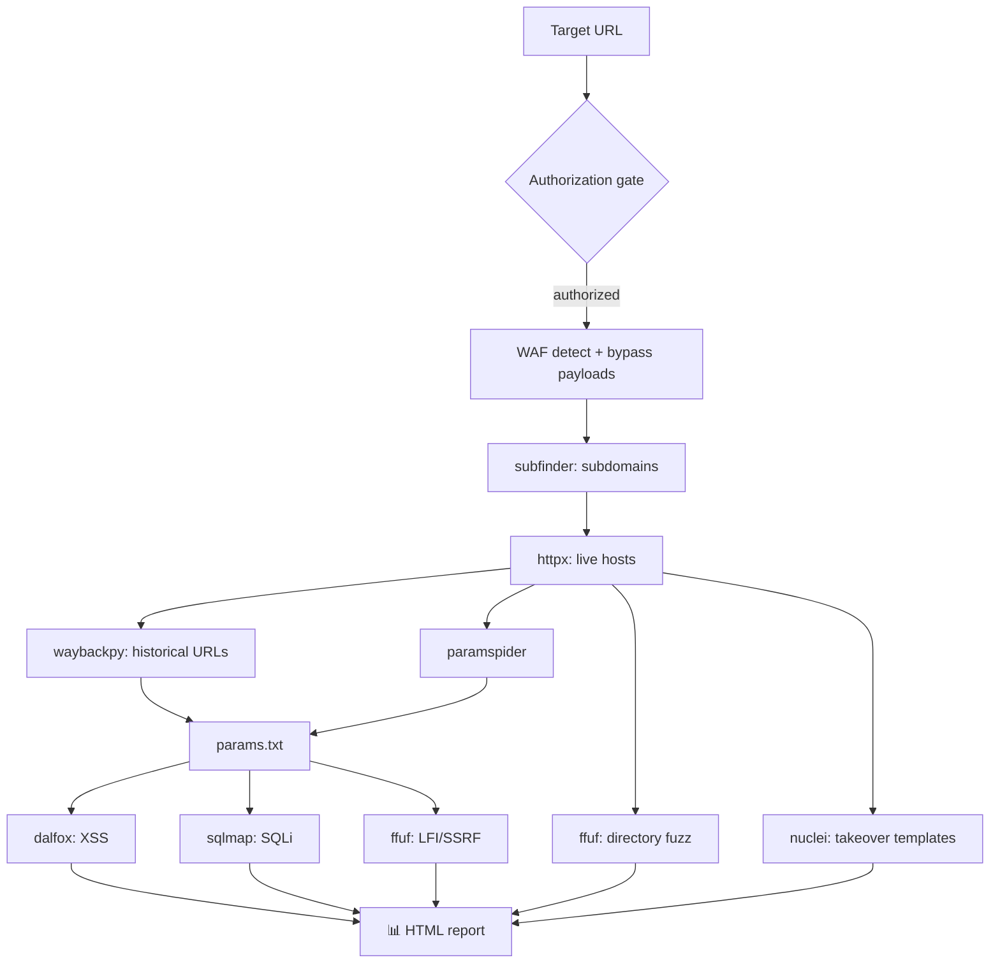

<div align="center">

# 🕶️ ShadowRecon

**Automated, Tor-anonymized reconnaissance & vulnerability pipeline for _authorized_ web-application testing.**


-informational)

</div>

> ⚠️ **Legal / ethical use only.** ShadowRecon performs active scanning and
> injection testing. Run it **only** against systems you own or are explicitly
> authorized to test. You are responsible for staying in scope and within the
> law. The tool enforces an authorization gate and a scope allowlist, but those
> are safeguards — not permission.

---

## ✨ Highlights

| | |
|---|---|
| 🔀 **Tor + ProxyChains** | Every request and tool run is routed through Tor; exit IP auto-rotates on `403`/`429`. |
| 🧱 **WAF-aware** | Fingerprints the WAF with `wafw00f` and runs a matching, preserved bypass payload set. |
| 🛰️ **Full recon** | Subdomains → live hosts → Wayback history → directory & parameter fuzzing. |
| 🎯 **Vuln scanning** | Pipelines parameterized URLs into Dalfox (XSS), SQLMap (SQLi) and FFUF (LFI/SSRF). |
| 🛡️ **Guardrails** | Authorization gate, scope allowlist, `--dry-run`, rate limiting, full audit log. |
| 📊 **Beautiful report** | One self-contained, offline **HTML report** aggregating every result. |
| 🎨 **Polished CLI** | Banner + colored logs + summary table (via `rich`, with a clean ANSI fallback). |

## 🗺️ Pipeline



## 📦 Project layout

```
main.py            # orchestrator, CLI, Tor/HTTP, safe subprocess, stages
waf_payloads.py    # WAF-bypass payload registry (data; preserved verbatim)
utils.py           # pure, dependency-free helpers (unit-tested)
report.py          # self-contained HTML report generator
console.py         # banner / logging / summary table (rich optional)
tests/             # unittest suite (also runs under pytest)
requirements.txt   # requests[socks], stem
ANALYSIS.md        # gap/vuln analysis + rationale for every change
```

## 🚀 Install

```bash
# Python deps
pip install -r requirements.txt   # optional extras: pip install rich

# External tools (Kali/Parrot/Debian)
sudo apt install tor proxychains4 ffuf sqlmap wafw00f
pipx install waybackpy paramspider
go install -v github.com/projectdiscovery/subfinder/v2/cmd/subfinder@latest
go install -v github.com/projectdiscovery/httpx/cmd/httpx@latest
go install -v github.com/projectdiscovery/nuclei/v3/cmd/nuclei@latest
go install github.com/hahwul/dalfox/v2@latest
```

Configure Tor's control port (`/etc/tor/torrc`):

```
ControlPort 9051
HashedControlPassword 16:...   # from: tor --hash-password <pass>
```

Then export the **plaintext** control password (never hardcode it):

```bash
export TOR_CONTROL_PASSWORD='your-plaintext-pass'
```

And point ProxyChains at Tor (`/etc/proxychains.conf`): `socks5 127.0.0.1 9050`.

## 🧪 Usage

```bash
# Review the entire plan without touching the target:
python3 main.py -u https://your-site.com/ -w wordlist.txt --dry-run

# Run for real (requires explicit authorization):
python3 main.py -u https://your-site.com/ -w wordlist.txt --authorized

# With LFI/SSRF fuzzing and a request throttle:
python3 main.py -u https://your-site.com/ -w words.txt \
    --lfi-payloads lfi.txt --rate-limit 0.5 --authorized
```

Artifacts land in `runs/<domain>-<timestamp>/`, including `audit.log` and a
`report.html` you can open in any browser.

| Flag | Purpose |
|---|---|
| `--authorized` | Assert you may scan the target (required for live runs). |
| `--dry-run` | Print every planned action; execute nothing. |
| `--rate-limit S` | Wait `S` seconds between HTTP requests. |
| `--no-proxychains` | Don't wrap external tools in proxychains. |
| `--no-report` | Skip HTML report generation. |
| `--yes` | Skip the interactive scope confirmation (automation). |

## 🔒 What this refactor did **not** change

Capability was deliberately left untouched: no new attack vectors, no expanded
or sharpened WAF-bypass payloads, no evasion improvements, and scan
aggressiveness stays at the original conservative levels. The work was
engineering quality, operator safety, and presentation only. See
[`ANALYSIS.md`](ANALYSIS.md).

## ✅ Tests

```bash
python -m unittest discover -s tests -v    # or: pytest -q
```
