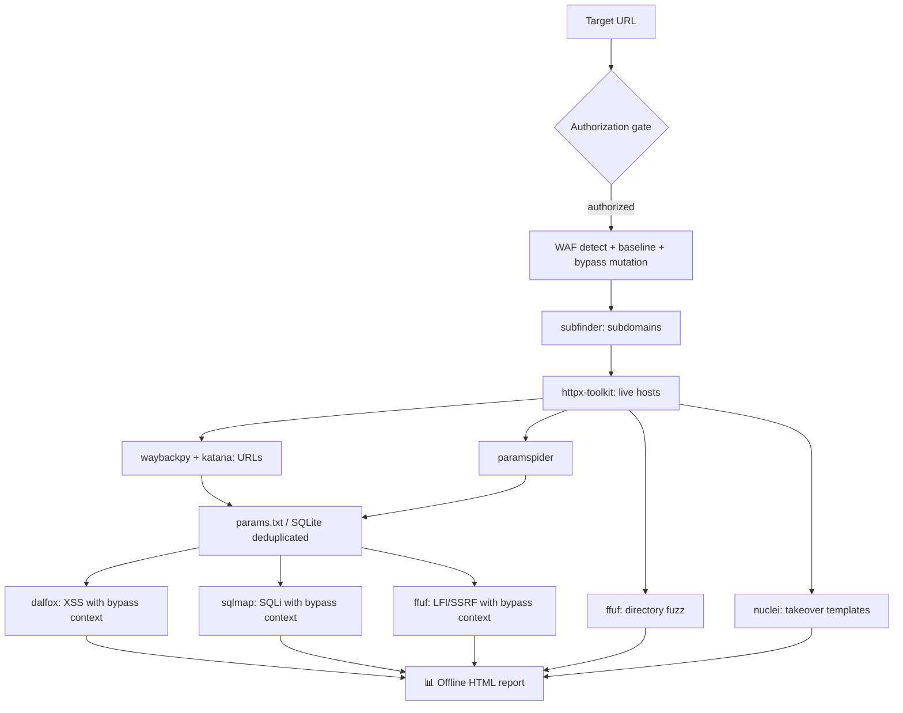

<div align="center">

# 🕶️ ShadowRecon

**Automated, Tor-anonymized reconnaissance & vulnerability pipeline for _authorized_ web-application testing.**


-informational)

</div>

> ⚠️ **Legal / ethical use only.** ShadowRecon performs active scanning and
> injection testing. Run it **only** against systems you own or are explicitly
> authorized to test. You are responsible for staying in scope and within the
> law. The tool enforces an authorization gate and a scope allowlist, but those
> are safeguards — not permission.

---

## ✨ Highlights

| | |
|---|---|
| 🔀 **Native Tor SOCKS5** | Direct native proxy injection (`-x`, `--proxy`, `-proxy-socks-url`) avoiding LD_PRELOAD proxychains DNS leaks. Auto-rotates exit circuit on `403`/`429`. |
| ⚡ **Async Streaming Pipeline** | Asynchronous event bus streams findings across stages concurrently with per-stage fault isolation. |
| 💾 **SQLite Run Persistence** | Full session persistence in `session.db`, allowing instant resume (`--force-rerun` to override). |
| 🧹 **URL Deduplication** | Deduplicates endpoints by parameter signature to prevent redundant scanning of identical interfaces. |
| 🧱 **WAF-aware & Mutation Bypass** | Fingerprints WAF (`wafw00f`), measures active blocking baseline, tests mutations, and propagates winning headers to scanners. |
| 🛰️ **Full recon** | Subdomains (`subfinder`) → live hosts (`httpx-toolkit`) → crawling & archives (`katana`, `paramspider`, `waybackpy`) → directory fuzzing (`ffuf`). |
| 🎯 **Vulnerability scanning** | Targeted scanning via Dalfox (XSS), SQLMap (SQLi), Nuclei (Takeover) and FFUF (LFI/SSRF). |
| 📊 **Offline HTML Report** | Self-contained, responsive dark HTML report with embedded SVG metrics, zero external CDN dependencies. |

## 🗺️ Pipeline



## 📦 Project layout

```
src/shadowrecon/   # Core v3.0 modular package
  ├── core/        # TorManager, AsyncExecutor, Scope validation
  ├── storage/     # SQLite SessionStore, deduplication, artifact export
  ├── pipeline/    # AsyncEventBus (pub/sub), PipelineRunner (fault isolation)
  ├── modules/     # Async stage wrappers (waf, recon, takeover, vuln)
  ├── reporting/   # Offline dark HTML report generator
  └── cli.py       # Asynchronous CLI runner and stage orchestrator
main.py            # CLI entrypoint delegating to shadowrecon.cli
pyproject.toml     # Standard Python packaging (pip install -e .)
tests/             # 58 automated unit tests across 5 test modules
waf_payloads.py    # WAF-bypass payload registry (data; preserved verbatim)
requirements.txt   # requests[socks], stem
```

## 🚀 Install

```bash
# Python deps
pip install -r requirements.txt   # optional extras: pip install rich

# External tools (Kali/Parrot/Debian)
sudo apt install tor proxychains4 ffuf sqlmap wafw00f httpx-toolkit
pipx install waybackpy paramspider
go install -v github.com/projectdiscovery/subfinder/v2/cmd/subfinder@latest
go install -v github.com/projectdiscovery/nuclei/v3/cmd/nuclei@latest
go install github.com/hahwul/dalfox/v2@latest
```

Configure Tor's control port (`/etc/tor/torrc`):

```
ControlPort 9051
HashedControlPassword 16:...   # from: tor --hash-password <pass>
```

Then export the **plaintext** control password (never hardcode it):

```bash
export TOR_CONTROL_PASSWORD='your-plaintext-pass'
```

And point ProxyChains at Tor (`/etc/proxychains.conf`): `socks5 127.0.0.1 9050`.

## 🧪 Usage

```bash
# Review the entire plan without touching the target:
python3 main.py -u https://your-site.com/ -w wordlist.txt --dry-run

# Run for real (requires explicit authorization):
python3 main.py -u https://your-site.com/ -w wordlist.txt --authorized

# Run selective stages (e.g., WAF check + subdomains + live hosts only):
python3 main.py -u https://your-site.com/ --stages waf,subdomains,probing --authorized

# Skip slow stages and run without proxy (if authorized directly):
python3 main.py -u https://your-site.com/ -w words.txt --skip-stages vuln_sqli,fuzzing --authorized

# Force rerun of previously completed stages:
python3 main.py -u https://your-site.com/ -w words.txt --force-rerun --authorized
```

Artifacts land in `runs/<domain>-<timestamp>/` (or custom `--outdir`), including `session.db` (SQLite state) and `report.html`.

| Flag | Purpose |
|---|---|
| `--authorized` | Assert you may scan the target (required for live runs). |
| `--dry-run` | Print every planned action and tool command; send zero live packets. |
| `--stages LIST` | Comma-separated list of stages to run (default: `all`). |
| `--skip-stages LIST` | Comma-separated list of stages to exclude (e.g. `vuln_sqli,fuzzing`). |
| `--force-rerun` | Rerun stages even if already marked as completed in session database. |
| `--config PATH` | Load options from a TOML configuration file (e.g. `shadowrecon.toml`). |
| `--threads N` | FFUF thread count (default: 5; kept conservative for Tor stability). |
| `--socks URL` | Tor SOCKS5 proxy URL (default: `socks5://127.0.0.1:9050`). |
| `--rate-limit S` | Wait `S` seconds between HTTP requests. |
| `--no-proxy` | Disable SOCKS proxy routing for direct network access. |
| `--no-report` | Skip HTML report generation. |
| `--yes` | Skip interactive scope confirmation (automation). |

## 🔒 What this refactor did **not** change

Capability was deliberately left untouched: no new attack vectors, no expanded
or sharpened WAF-bypass payloads, no evasion improvements, and scan
aggressiveness stays at the original conservative levels. The work was
engineering quality, operator safety, and presentation only. See
[`ANALYSIS.md`](ANALYSIS.md).

## ✅ Tests

```bash
python -m unittest discover -s tests -v    # or: pytest -q
```
